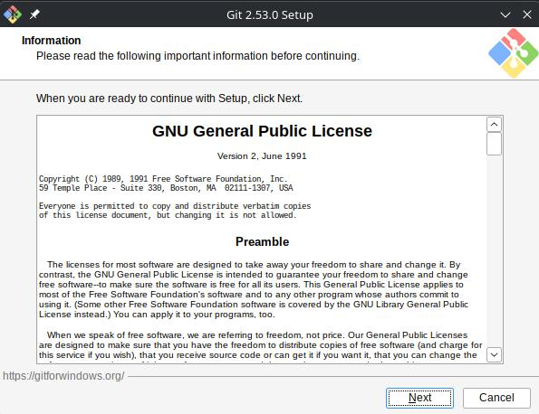
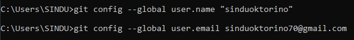

# prak-dis-dec

👨‍💻 Tujuan Praktikum

Praktikum ini bertujuan untuk memberikan pemahaman mendalam serta keterampilan praktis kepada mahasiswa atau praktikan mengenai penggunaan Distributed Version Control System (DVCS) berbasis Git dan platform kolaborasi GitHub. Melalui praktikum ini, praktikan diharapkan mampu mengonfigurasi repositori lokal dan terhubung ke repositori jarak jauh (remote repository), mengelola riwayat perubahan kode melalui alur kerja commit, serta berkolaborasi secara terstruktur dengan memanfaatkan fitur bercabang (branching), penggabungan kode (merging), pemulihan riwayat (checkout/reset), dan pengajuan kontribusi kode melalui mekanisme pull request.

👨‍💻 Dasar Teori Praktikum

Dasar teori yang melandasi materi ini berpusat pada konsep sistem kontrol versi yang memungkinkan pengembang merekam setiap rekam jejak dan perombakan dalam berkas proyek dari waktu ke waktu secara terdistribusi. Git bekerja dengan menyimpan snapshot perubahan pada repositori lokal, sehingga setiap anggota tim dapat bekerja secara independen tanpa bergantung penuh pada koneksi server terpusat. Sementara itu, GitHub berperan sebagai platform komputasi awan yang memfasilitasi sinkronisasi riwayat repositori lokal ke repositori jarak jauh, sekaligus menyediakan infrastruktur pelacak isu (issue tracker), mekanisme tinjauan kode (code review), dan manajemen proyek kolaboratif untuk menjamin efisiensi serta integritas perangkat lunak yang dikembangkan secara bersama.

Praktikum

1.

Pembahasan:
Gambar diatas merupakan salah satu tahapan awal dalam proses instalasi aplikasi Git for Windows di komputer. Pada jendela instalasi ini ditampilkan informasi mengenai lisensi perangkat lunak yaitu GNU General Public License. Pengguna diminta untuk membaca ketentuan dan informasi penting terkait penggunaan perangkat lunak tersebut sebelum melanjutkan proses instalasi. Setelah membaca ketentuan lisensi yang tertera, pengguna dapat mengklik tombol next untuk melanjutkan ke tahap pengaturan instalasi berikutnya.

2.

Pembahasan:
Gambar diatas menunjukkan tahapan pemilihan lokasi penyimpanan untuk instalasi aplikasi Git di dalam komputer. Pada jendela tersebut terdapat kolom direktori tujuan di mana secara default sistem akan menginstal program Git ke dalam folder program files. Pengguna juga dapat mengubah lokasi penyimpanan folder tersebut dengan mengeklik tombol browse jika diinginkan. Selain itu terdapat informasi mengenai kapasitas ruang kosong pada disk yang diperlukan untuk melanjutkan proses pemasangan perangkat lunak. Setelah menentukan lokasi folder tujuan, pengguna dapat mengeklik tombol next untuk melanjutkan ke langkah berikutnya.

3.

Pembahasn:
Gamnar diatas adalah tahap pemilihan komponen tambahan untuk instalasi git yang memungkinkan pengguna mencentang berbagai fitur pendukung seperti integrasi windows explorer dan dukungan file besar sesuai kebutuhan sebelum melanjutkan ke langkah berikutnya.

4.

Pembahasan:
Gambar diatas adalah tahap penentuan nama folder shortcut program pada Start Menu Windows agar aplikasi mudah diakses, di mana pengguna dapat memilih lokasi penyimpanan pintasan atau mencentang opsi untuk tidak membuatnya.

5.

Pembahasan:
Gambar diatas adalah tahap pemilihan aplikasi teks editor bawaan yang akan digunakan oleh Git, di mana pengguna dapat memilih berbagai editor seperti Vim, Nano, Notepad, atau Visual Studio Code melalui menu dropdown sesuai kenyamanan penggunaan.

6.

Pembahasan:
Gambar diatas merupakan tahap pengaturan nama branch utama untuk repository baru di mana pengguna dapat memilih untuk menggunakan nama bawaan sistem seperti master atau mengubahnya secara manual menjadi main sesuai kebutuhan

7.

Pembahasan:
Gambar diatas merupakan tahap konfigurasi path environment untuk menentukan cara penggunaan git dari command line, di mana opsi yang direkomendasikan dipilih agar perintah git dapat dijalankan melalui git bash, command prompt, powershell, maupun aplikasi pihak ketiga lainnya

8.

Pembahasan:
Gambar diatas adalah tahap pemilihan pustaka SSL/TLS yang digunakan oleh Git untuk koneksi HTTPS, di mana pengguna dapat memilih antara menggunakan pustaka OpenSSL atau pustaka bawaan Windows Secure Channel sesuai kebutuhan sistem

9.

Pembahasan:
Gambar diatas adlah tahap konfigurasi penanganan akhir baris teks pada file, di mana opsi yang disarankan dipilih agar git secara otomatis mengonversi format baris saat melakukan checkout dan commit antar sistem operasi yang berbeda

10.

Pembahasan:
Gambar diatas adalah tahap pemilihan emulator terminal yang akan digunakan bersama git bash, di mana pengguna dapat memilih menggunakan mintty sebagai emulator bawaan msys2 yang memiliki jendela yang dapat diubah ukurannya atau menggunakan console window bawaan windows

11.

Pembahasan:
Gambar diatas adalah tahap pengaturan perilaku bawaan untuk perintah git pull yang menentukan bagaimana pembaruan kode dari server digabungkan ke repositori lokal, baik melalui metode penggabungan otomatis maupun rebase.

12.

Pembahasan:
Gambar diatas adalah tahap pemilihan pengelola kredensial untuk membantu menyimpan informasi akun git secara otomatis agar pengguna tidak perlu memasukkan kata sandi setiap kali melakukan interaksi dengan repositori jarak jauh.

13.

Pembahasan:
Gambar diatas adalaha tahap konfigurasi opsi tambahan untuk mengaktifkan fitur caching sistem file agar kinerja operasi git menjadi lebih cepat dan optimal sebelum proses instalasi dimulai.

14.

Pembahasan:
Gambar diatas adalah tahap proses instalasi yang sedang berjalan di mana sistem menyalin dan mengekstrak berkas program git ke dalam direktori penyimpanan komputer secara otomatis.

15.

Pembahasan:
Tahap penyelesaian proses pemasangan di mana aplikasi git telah berhasil terinstal secara keseluruhan pada komputer dan pengguna dapat mengeklik tombol finish untuk menutup jendela pengaturan.

Cek Git

1. 

Pembahasan:
Gambar tersebut menunjukkan tampilan terminal command prompt di mana perintah git telah dijalankan dan menampilkan daftar berbagai perintah umum git yang tersedia beserta penjelasan singkat fungsinya, seperti clone untuk menyalin repositori, init untuk membuat repositori baru, add untuk menambahkan perubahan, commit untuk menyimpan perubahan, hingga fetch untuk mengambil data dari repositori jarak jauh.

2.

Pembahasan:
Gambar tersebut menunjukkan tampilan terminal command prompt di mana perintah git --version dijalankan untuk memeriksa versi git yang terpasang pada komputer, dan sistem berhasil menampilkan informasi bahwa versi git yang aktif adalah versi 2.56.0 untuk windows.

Konfigurasi GitHub

1.

Pembahasan:
Gambar diatas menunjukkan tahap konfigurasi identitas pengguna pada git secara global, di mana perintah git config global user name dan git config global user email dijalankan untuk mendaftarkan nama akun serta alamat email agar setiap riwayat perubahan kode atau commit yang dilakukan teridentifikasi dengan jelas pada repositori.

2.

Pembahasan:
Gambar diatas memperlihatkan isi dari file konfigurasi global Git bernama titik git config yang terbuka di dalam teks editor, di mana terdapat bagian identitas pengguna yang menampilkan nama pengguna sinduoktorino serta alamat email sinduoktorino70@gmail.com yang telah berhasil disimpan secara permanen pada sistem komputer.

3.

Pembahasan:
Gambar diatas memperlihatkan proses pengecekan seluruh konfigurasi git yang aktif pada komputer melalui perintah git config list di terminal command prompt. Melalui tampilan tersebut, sistem mencetak berbagai parameter pengaturan yang telah diterapkan sebelumnya mulai dari filter lfs, pengaturan ssl backend, autocrlf, fscache, credential helper hingga identitas akun pengguna atas nama sinduoktorino dengan alamat email sinduoktorino70@gmail.com.

👨‍💻 Kesimpulan

Penggunaan Git dan GitHub secara terintegrasi terbukti efisien dalam mempermudah alur kerja pengembangan perangkat lunak modern. Pemahaman terhadap alur kendali versi lokal hingga sinkronisasi repositori awan memungkinkan pengembang untuk melacak rekam jejak perubahan kode secara rinci, meminimalkan risiko konflik kode, serta meningkatkan efektivitas kolaborasi dalam tim pengembang.