Nim : 255410033
Nama: Mohamad Sindu Oktorino

👨‍💻 Tujuan Praktikum

👨‍💻 Dasar Teori

Praktikum

**A. Proses pada Satu Node**

1.

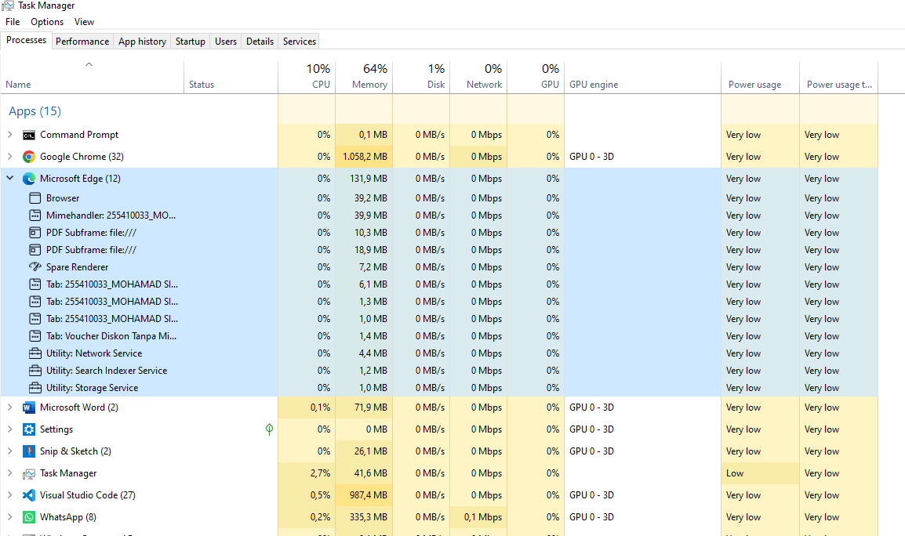

2.

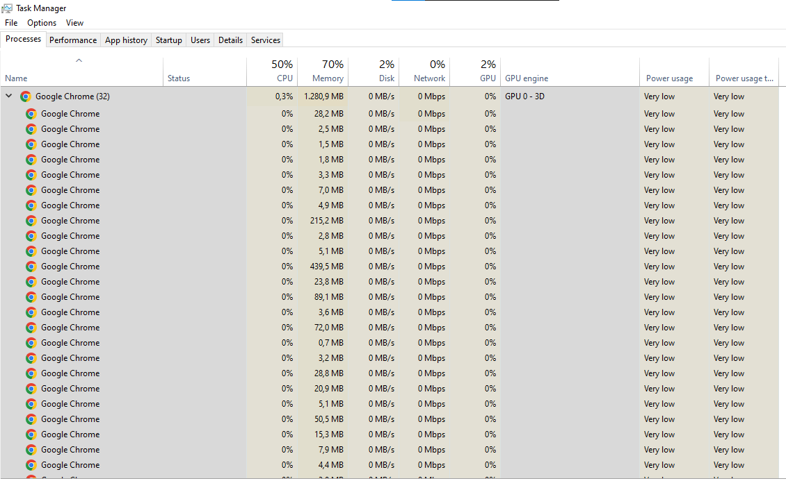

3.

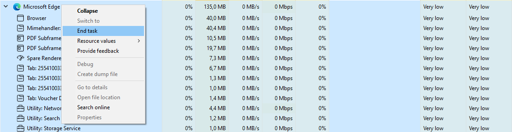
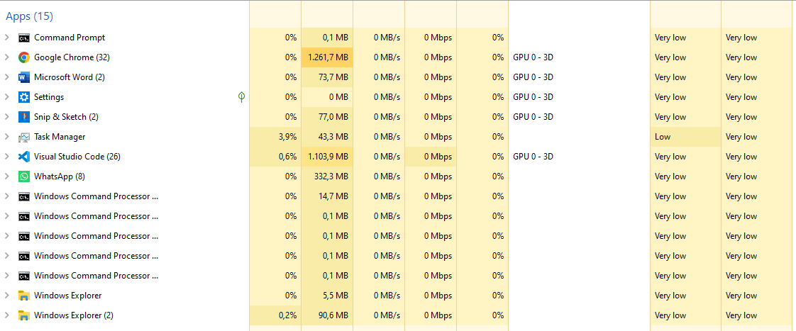

4.
-. **Menampilkan Proses:** Membuka Task Manager (`Ctrl + Shift + Esc`) untuk melihat seluruh aplikasi dan proses yang sedang berjalan pada sistem operasi.

-. **Menjalankan Aplikasi:** Membuka Microsoft Edge untuk melihat proses utamanya yang terpecah menjadi beberapa proses turunan di Task Manager demi keamanan dan kestabilan sistem.

- **Mematikan Proses Paksa:** Menghentikan Microsoft Edge tanpa tombol keluar (`X`), melainkan melalui fitur *End task* di Task Manager atau perintah `taskkill /f /im msedge.exe` pada Command Prompt untuk memaksa sistem melepaskan alokasi *resources*-nya.
- **Me-restart Proses:** Setelah proses dimatikan paksa oleh sistem, aplikasi dapat di-*restart* dengan membukanya kembali dari awal.

**B Komunikasi Antar Proses pada Sistem Terdistribusi**

1.

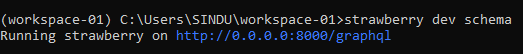

Pembahasan:

2.

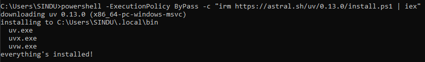

Pembahasan:

3.

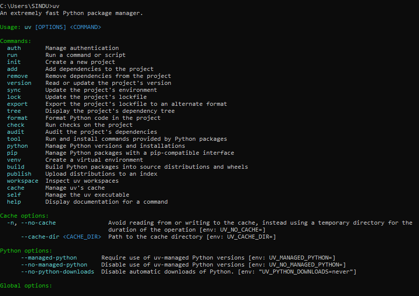
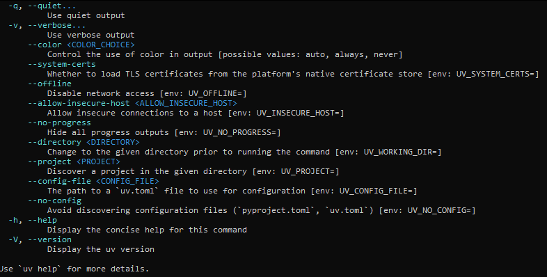

Pembahasan:

4.

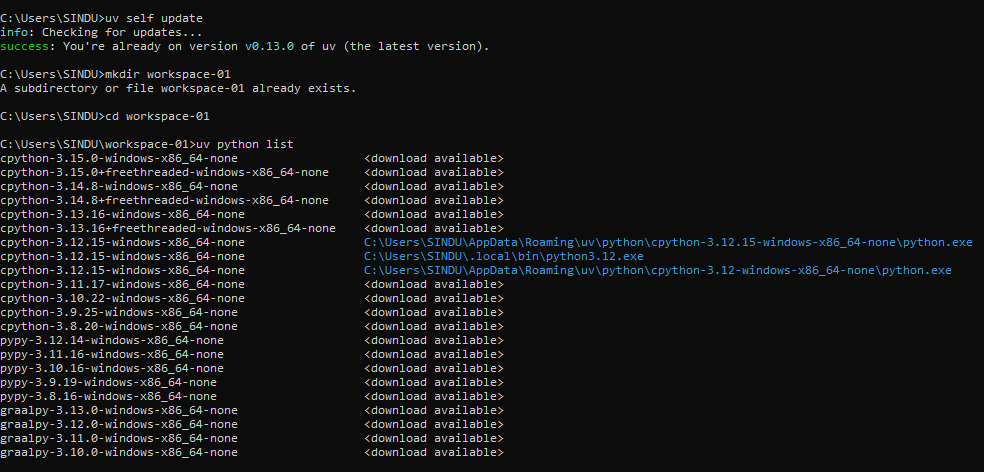

Pembahasan:

5.

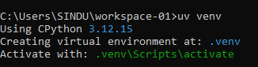

Pembahasan:

6.

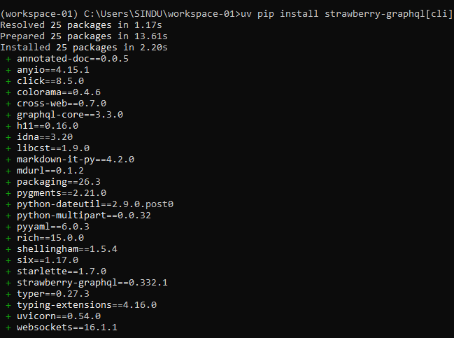

Pembahasan:

7.

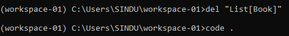
Pembahasan:

8.

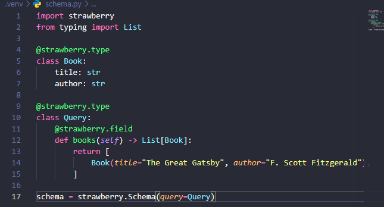

Pembahasan:

9.

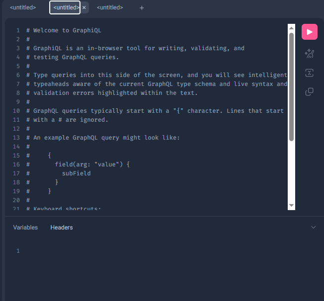

Pembahasan:

10.

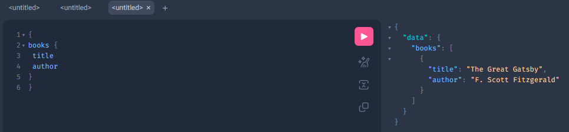

Pembahasan:

💥Kesimpulan
