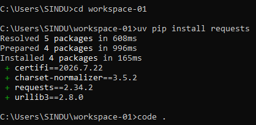
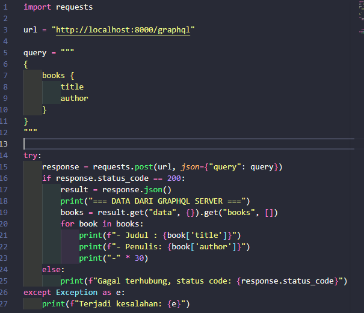
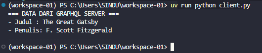

🪪 **NIM:** 255410033 
👤 **Nama:** Mohamad Sindu Oktorino

## 🎯 Tujuan Praktikum
Agar mahasiswa mampu memahami, mempelajari, dan mengimplementasikan sistem terdistribusi dengan membangun server menggunakan Strawberry GraphQL serta membuat program client berbasis Python guna mengakses dan mengambil data dari server tersebut.
## 📚 Dasar Teori
Praktikum ini mencakup penggunaan GraphQL sebagai bahasa kueri untuk API yang memberikan keleluasaan kepada client untuk meminta struktur data spesifik melalui satu endpoint, serta penerapan konsep arsitektur client-server dalam sistem terdistribusi yang memanfaatkan protokol komunikasi web
## 🧪 Praktikum

### 🖥️ A. Proses pada Satu Node

1.

2.

3.

4.
- **Menampilkan Proses:** Membuka Task Manager (`Ctrl + Shift + Esc`) untuk melihat seluruh aplikasi dan proses yang sedang berjalan pada sistem operasi.

- **Menjalankan Aplikasi:** Membuka Microsoft Edge untuk melihat proses utamanya yang terpecah menjadi beberapa proses turunan di Task Manager demi keamanan dan kestabilan sistem.

- **Mematikan Proses Paksa:** Menghentikan Microsoft Edge tanpa tombol keluar (`X`), melainkan melalui fitur *End task* di Task Manager atau perintah `taskkill /f /im msedge.exe` pada Command Prompt untuk memaksa sistem melepaskan alokasi *resources*-nya.

- **Me-restart Proses:** Setelah proses dimatikan paksa oleh sistem, aplikasi dapat di-*restart* dengan membukanya kembali dari awal.

### 🌐 B. Komunikasi Antar Proses pada Sistem Terdistribusi

1.

**Pembahasan:** Gambar ini menunjukkan contoh data buku dalam format GraphQL, dengan kolom judul dan penulis, serta hasil data yang dikembalikan dalam format JSON.

2.

**Pembahasan:** Terminal menampilkan daftar perintah dan opsi yang tersedia pada `uv`, sebuah alat untuk mengelola proyek dan paket Python.

3.

**Pembahasan:** Gambar memperlihatkan editor GraphiQL dan server Strawberry yang berjalan pada alamat lokal `http://127.0.0.1:8000/graphql`, sehingga endpoint GraphQL siap menerima permintaan.

4.

**Pembahasan:** Perintah PowerShell pada gambar digunakan untuk mengunduh dan menjalankan skrip instalasi `uv` pada Windows.

5.

**Pembahasan:** Gambar menampilkan opsi bantuan `uv`, termasuk pengaturan direktori kerja, file konfigurasi, akses jaringan, dan informasi versi.

6.

**Pembahasan:** Terminal menunjukkan pembaruan `uv`, pembuatan folder proyek, serta daftar versi Python yang tersedia untuk digunakan.

7.

**Pembahasan:** Perintah `uv venv` membuat virtual environment menggunakan Python 3.12.15 agar dependensi proyek terpisah dari instalasi Python utama.

8.

**Pembahasan:** Perintah `uv pip install strawberry-graphql[cli]` memasang Strawberry GraphQL beserta dependensi yang diperlukan untuk menjalankan server GraphQL.

9.

**Pembahasan:** Kode mendefinisikan tipe GraphQL `Book` dengan kolom judul dan penulis, lalu menyiapkan query yang mengembalikan data sebuah buku.

10.

**Pembahasan:** Terminal menampilkan perintah untuk menghapus `List[Book]` dan membuka folder proyek di editor melalui `code .`.

### 📝 TUGAS

1.

**Pembahasan:** Gambar menunjukkan pemasangan pustaka `requests` menggunakan `uv pip`, yang diperlukan agar program Python dapat mengirim permintaan HTTP.

2.

**Pembahasan:** Kode Python mengirim query GraphQL ke server lokal melalui HTTP POST, lalu membaca dan menampilkan data buku dari respons server.

3.

**Pembahasan:** Hasil eksekusi program menampilkan data buku yang diterima dari server GraphQL, yaitu judul “The Great Gatsby” dan penulis F. Scott Fitzgerald.

## ✅ Kesimpulan
Server GraphQL berhasil dijalankan untuk menyediakan data skema, dan program client Python berhasil terhubung serta sukses menarik data tersebut secara akurat.
