# 📚 Praktikum 03 — Sistem Terdistribusi

| Informasi | Detail |
|---|---|
| **NIM** | 255410033 |
| **Nama** | Mohamad Sindu Oktorino |

## 🎯 Tujuan Praktikum

Praktikum ini bertujuan memahami konsep dasar sistem terdistribusi melalui penerapan sinkronisasi waktu dan pencatatan urutan kejadian menggunakan Vector Clock. Praktikum ini juga bertujuan mempelajari masalah yang dapat muncul pada proses yang berjalan bersamaan, seperti data race dan deadlock, serta memahami cara mencegahnya menggunakan mekanisme sinkronisasi. Selain itu, praktikum ini mengenalkan algoritma Raft sebagai salah satu metode untuk mencapai konsensus dan menjaga konsistensi data pada sistem terdistribusi.

## 🧠 Dasar Teori

_Tambahkan ringkasan dasar teori di sini._

## 🧪 Praktikum

### 3.1 🕒 Sinkronisasi Waktu

Instal [NetTime](https://www.timesynctool.com/), lalu gunakan aplikasi tersebut untuk menyinkronkan waktu dengan server NTP.

#### ⬇️ Unduhan

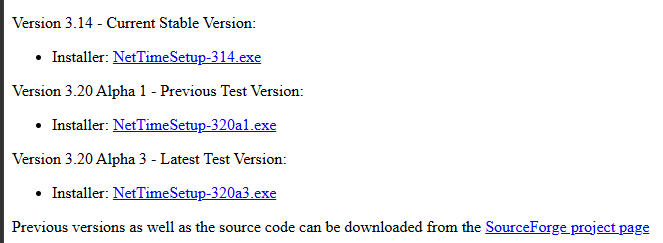

> **Pembahasan:** _Proses pengunduhan NetTime dilakukan melalui situs resminya. Pada halaman unduhan, tersedia installer NetTime versi stabil yang digunakan untuk memasang aplikasi pada sistem operasi Windows. Pengguna memilih tautan installer, kemudian mengunduh berkas instalasi agar aplikasi dapat dipasang di komputer._

#### 🛠️ Langkah setup

**🔹 Langkah 1**

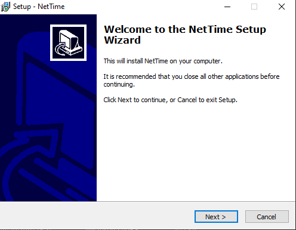

> **Pembahasan:** _Pada tahap awal, jendela NetTime Setup Wizard menampilkan halaman sambutan. Pengguna diminta menutup aplikasi lain sebelum melanjutkan instalasi. Klik Next untuk masuk ke tahap berikutnya._

**🔹 Langkah 2**

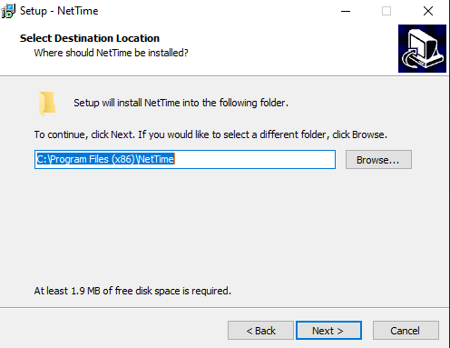

> **Pembahasan:** _Pada tahap ini, pengguna menentukan folder tempat NetTime akan dipasang. Lokasi bawaan berada di folder Program Files (x86). Jika tidak ada kebutuhan khusus, lokasi tersebut dapat dipertahankan. Klik Next untuk melanjutkan._

**🔹 Langkah 3**

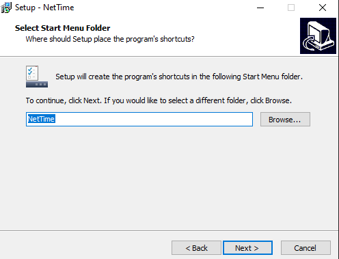

> **Pembahasan:** _Tahap ini menentukan nama folder pintasan NetTime pada Start Menu Windows. Nama bawaan NetTime dapat digunakan agar aplikasi mudah ditemukan. Klik Next untuk melanjutkan proses instalasi._

**🔹 Langkah 4**

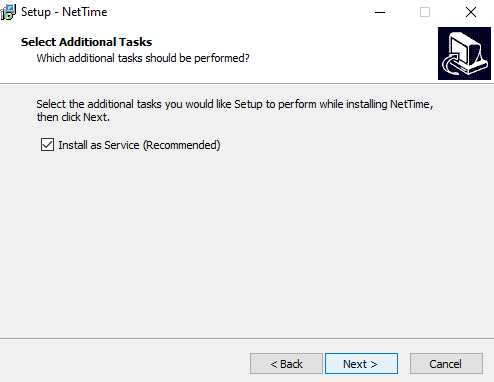

> **Pembahasan:** _Pada tahap Select Additional Tasks, tersedia opsi Install as Service (Recommended). Opsi ini memungkinkan NetTime berjalan sebagai layanan Windows sehingga proses sinkronisasi waktu dapat dilakukan tanpa harus membuka aplikasi secara manual setiap saat. Klik Next setelah memilih opsi tersebut._

**🔹 Langkah 5**

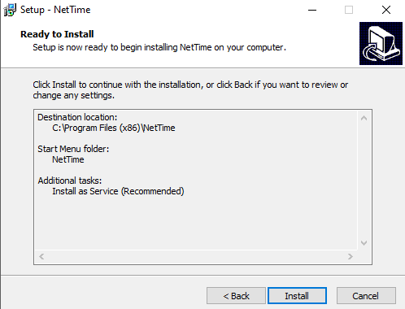

> **Pembahasan:** _Halaman Ready to Install menampilkan ringkasan pengaturan instalasi, termasuk lokasi pemasangan dan tugas tambahan yang dipilih. Periksa pengaturan tersebut, lalu klik Install untuk memulai pemasangan NetTime pada komputer._

**🔹 Langkah 6**

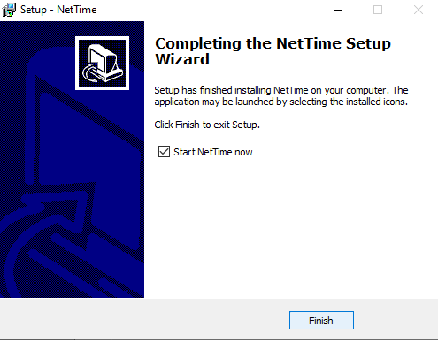

> **Pembahasan:** _Tahap terakhir menunjukkan bahwa instalasi NetTime telah selesai. Opsi Start NetTime now dapat digunakan untuk langsung membuka aplikasi setelah instalasi. Klik Finish untuk menutup wizard dan menyelesaikan proses pemasangan._

### 3.2 🧮 Vector Clock

#### 🔄 Simulasi Vector Clock

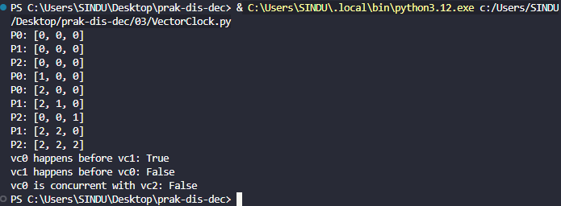

> **Pembahasan:** _Vector clock digunakan untuk menentukan urutan kejadian pada sistem terdistribusi. Setiap proses memiliki vektor penghitung yang diperbarui ketika proses menjalankan suatu kejadian atau menerima pesan. Mekanisme ini membantu mengetahui hubungan urutan antarperistiwa tanpa bergantung sepenuhnya pada jam fisik komputer._

#### 📝 Tugas Vector Clock

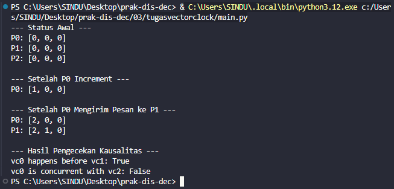

> **Pembahasan:** _Program vector clock dijalankan untuk mengamati perubahan nilai vektor pada setiap kejadian. Jika dihitung secara manual, setiap proses menambah nilai penghitungnya sendiri ketika terjadi kejadian lokal. Saat menerima pesan, proses menggabungkan nilai vektor yang diterima dengan vektor miliknya menggunakan nilai maksimum pada setiap posisi, kemudian menambah penghitungnya sendiri. Implementasi dalam modul Python memudahkan proses tersebut digunakan kembali pada program lain._

### 3.3 ⚠️ Problem Tanpa Sinkronisasi

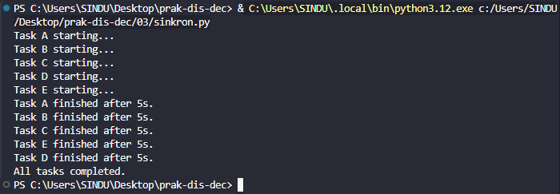

> **1. Pembahasan:** _Program multithreaded menunjukkan bahwa beberapa thread dapat berjalan dengan urutan yang berbeda. Perbedaan waktu eksekusi membuat urutan keluaran program tidak selalu sama pada setiap percobaan. Hal ini terjadi karena sistem operasi mengatur penjadwalan thread secara dinamis._

> **2. Pembahasan:** _Program dijalankan berulang kali hingga menghasilkan keluaran yang berbeda. Perbedaan tersebut terjadi karena setiap thread dapat memperoleh waktu eksekusi yang berbeda. Akibatnya, urutan operasi dan keluaran yang ditampilkan dapat berubah meskipun program menggunakan kode yang sama._

#### 3.3.1 🧵 Data Race / Race Conditions

**⚡ Contoh race condition**

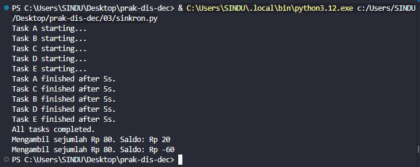

> **Pembahasan:** _Race condition terjadi ketika beberapa thread mengakses atau mengubah data yang sama tanpa pengaturan akses yang tepat. Operasi yang seharusnya berjalan secara berurutan dapat saling tumpang tindih. Akibatnya, nilai akhir data berpotensi tidak sesuai dengan hasil yang diharapkan._

**📉 Diagram race condition**

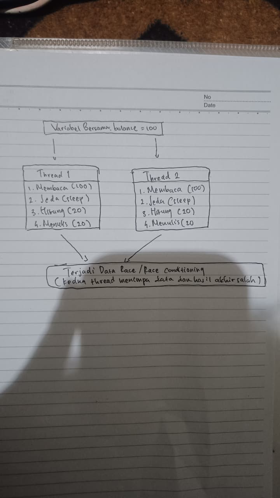

> **Pembahasan:** _Visualisasi race condition dapat dibuat dengan menggambarkan dua thread yang membaca nilai variabel yang sama, kemudian melakukan perubahan secara bersamaan. Kedua thread dapat membaca nilai lama sebelum salah satunya menyimpan hasil perubahan. Akibatnya, salah satu perubahan dapat hilang dan menghasilkan nilai akhir yang tidak tepat._

**🔐 Pencegahan dengan lock (`race-conditions-02.py`)**

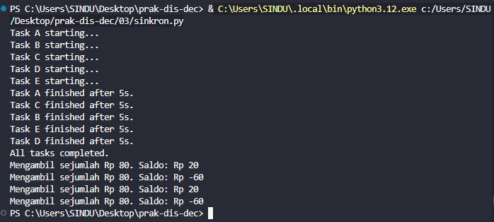

  **1.**

> **Pembahasan:** _Program perbaikan dijalankan untuk mengamati perubahan hasil setelah akses terhadap data bersama diatur._

  **2.**

> **Pembahasan:** _Race condition dapat dicegah menggunakan mekanisme sinkronisasi, seperti lock, yang memastikan hanya satu thread pada satu waktu yang menjalankan bagian kode kritis. Dengan demikian, perubahan data berlangsung secara teratur dan hasilnya lebih konsiste._

#### 3.3.2 🔒 Deadlock

**⛔ Contoh deadlock**

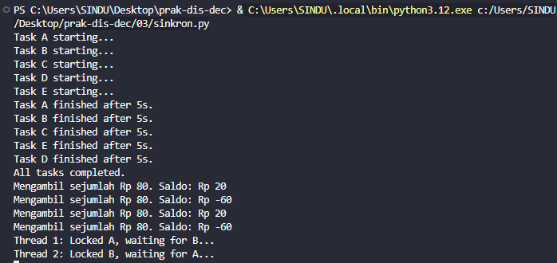

> **Pembahasan:** _Deadlock merupakan kondisi ketika dua atau lebih thread saling menunggu sumber daya yang sedang dikunci oleh thread lain. Akibatnya, thread yang terlibat tidak dapat melanjutkan prosesnya. Kondisi ini dapat menyebabkan program berhenti merespons._

**🔄 Diagram deadlock**

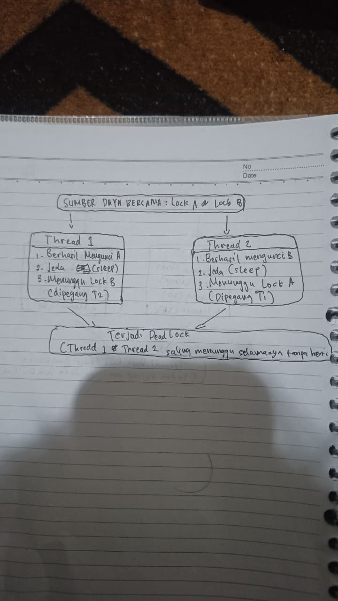

> **Pembahasan:** _Visualisasi deadlock dapat dibuat dengan menggambarkan dua thread dan dua sumber daya. Thread pertama memegang sumber daya A dan menunggu sumber daya B. Sementara itu, thread kedua memegang sumber daya B dan menunggu sumber daya A. Kedua thread saling menunggu sehingga tidak ada yang dapat melanjutkan eksekusi._

**⏱️ Pencegahan dengan timeout (`deadlock-02.py`)**

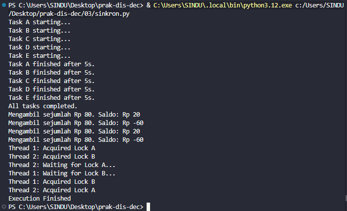

> **Pembahasan:** _Program perbaikan dijalankan untuk mengamati bagaimana deadlock dapat dihindari._

**💡 Hasil tambahan**

> **Pembahasan:** _ Salah satu cara yang umum digunakan adalah mengatur urutan pengambilan lock agar setiap thread memperoleh sumber daya dalam urutan yang konsisten. Pengaturan tersebut dapat mencegah kondisi saling menunggu yang menyebabkan deadlock._

### 3.4 🗳️ Algoritma Raft

#### ⚙️ Konfigurasi dan simulasi

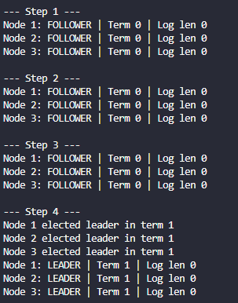

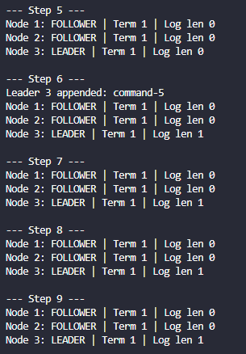

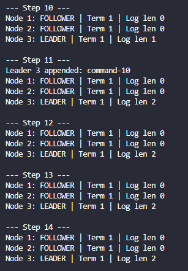

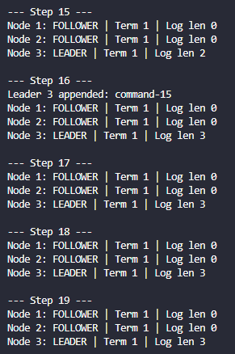

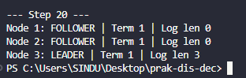

> **Pembahasan:** _Program simulasi Raft dijalankan untuk mengamati proses pemilihan leader. Ketika follower tidak menerima heartbeat dari leader, node tersebut dapat memulai pemilihan dengan meningkatkan nomor term dan mengajukan permintaan suara kepada node lain. Jika memperoleh mayoritas suara, candidate menjadi leader dan mengirimkan heartbeat untuk mempertahankan status kepemimpinannya._

#### 🔀 Diagram Raft

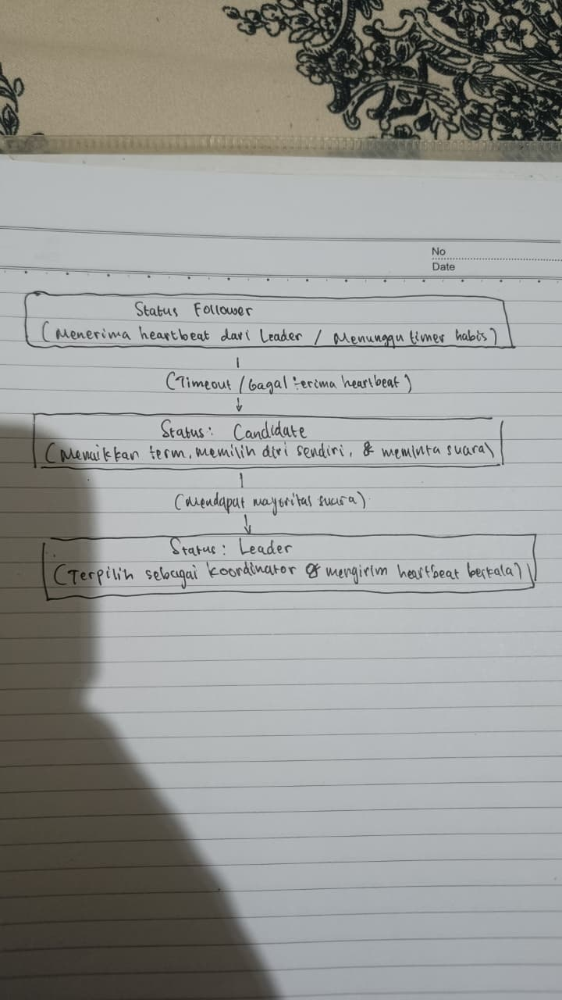

> **Pembahasan:** _Visualisasi manual dapat menggambarkan beberapa node yang awalnya berstatus follower. Salah satu node kemudian menjadi candidate dan meminta suara dari node lain. Setelah memperoleh mayoritas suara, node tersebut berubah menjadi leader. Node lainnya mengikuti koordinasi dari leader terpilih. Proses ini membantu menjelaskan bagaimana Raft mencapai kesepakatan mengenai pemimpin dalam sistem terdistribusi._

#### 💻 Output program

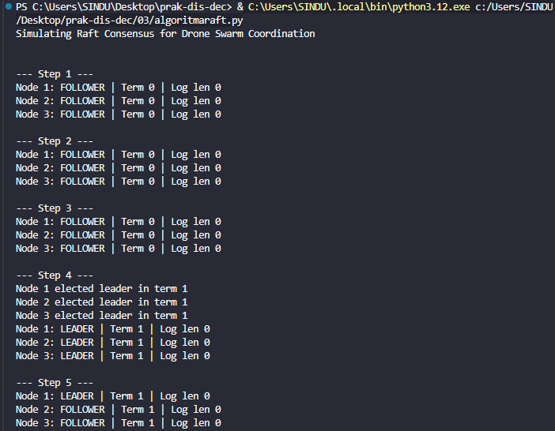

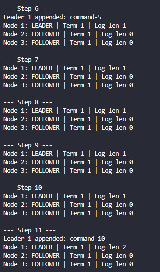

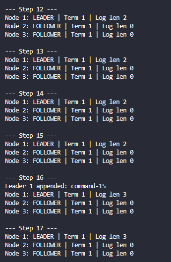

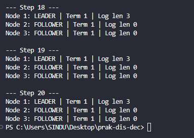

> **Pembahasan:** _Program Raft diubah menjadi modul Python agar fungsi-fungsi utamanya dapat digunakan kembali pada program lain. Modul tersebut kemudian dipanggil melalui program simulasi untuk memperlihatkan proses pemilihan leader. Pemisahan kode ke dalam modul membuat program lebih terstruktur, mudah diuji, dan lebih mudah dikembangkan._

## ✅ Kesimpulan

Praktikum ini menunjukkan bahwa sistem terdistribusi memerlukan cara untuk menyelaraskan waktu dan memahami urutan kejadian karena setiap proses dapat berjalan secara independen. Vector Clock dapat membantu menggambarkan hubungan kausal antarperistiwa. Eksekusi bersamaan juga dapat menimbulkan data race dan deadlock, sehingga diperlukan mekanisme seperti lock dan pengaturan timeout untuk mengelolanya. Melalui simulasi Raft, praktikum ini juga memperkenalkan pentingnya konsensus agar beberapa node dapat menyepakati keadaan sistem secara konsisten.
