Nama    : Mohamad Sindu Oktorino
Nim     : 255410033


TUJAN PRAKTIKUM


DASAR TEORI


PRAKTIKUM

4.1.1 Instalasi Docker

1. Instal docker melalui website docker docs
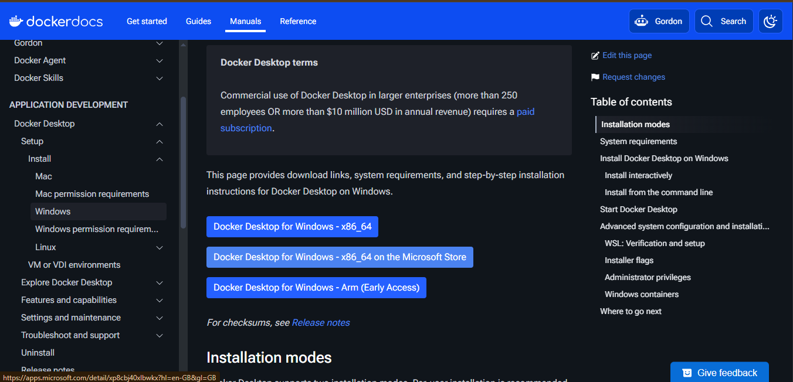

Pembahasan:

2. Proses instalasi
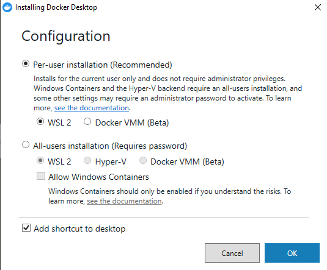

Pembahasan:

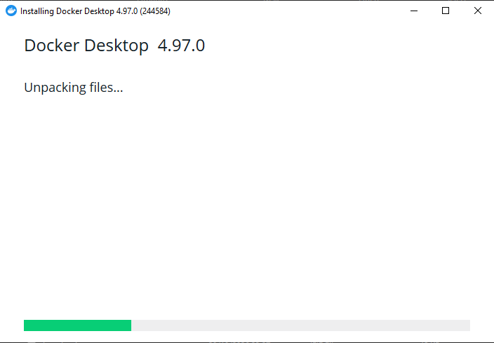

Pembahasan:

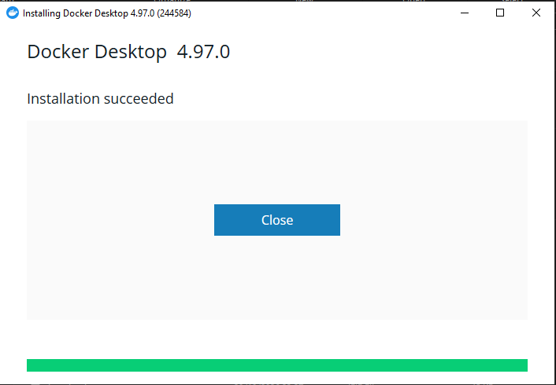

Pembahasan:

Cek versi docker yang digunakan

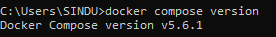

Pembahasan:


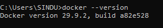

Pembahasan:

Cek docker info

```text
C:\Users\SINDU>docker info
Client:
 Version:    29.9.2
 Context:    desktop-linux
 Debug Mode: false
 Plugins:
  agent: Docker AI Agent Runner (Docker Inc.)
    Version:  v1.152.0
    Path:     C:\Users\SINDU\.docker\cli-plugins\docker-agent.exe
  ai: Docker AI Agent - Ask Gordon (Docker Inc.)
    Version:  v1.33.0
    Path:     C:\Users\SINDU\.docker\cli-plugins\docker-ai.exe
  buildx: Docker Buildx (Docker Inc.)
    Version:  v0.38.1
    Path:     C:\Users\SINDU\.docker\cli-plugins\docker-buildx.exe
  compose: Docker Compose (Docker Inc.)
    Version:  v5.6.1
    Path:     C:\Users\SINDU\.docker\cli-plugins\docker-compose.exe
  debug: Get a shell into any image or container (Docker Inc.)
    Version:  0.49.0
    Path:     C:\Users\SINDU\.docker\cli-plugins\docker-debug.exe
  desktop: Docker Desktop commands (Docker Inc.)
    Version:  4.97.0
    Path:     C:\Users\SINDU\.docker\cli-plugins\docker-desktop.exe
  dhi: CLI for managing Docker Hardened Images (Docker Inc.)
    Version:  v0.0.9
    Path:     C:\Users\SINDU\.docker\cli-plugins\docker-dhi.exe
  extension: Manages Docker extensions (Docker Inc.)
    Version:  v0.2.32
    Path:     C:\Users\SINDU\.docker\cli-plugins\docker-extension.exe
  init: Creates Docker-related starter files for your project (Docker Inc.)
    Version:  v1.4.1
    Path:     C:\Users\SINDU\.docker\cli-plugins\docker-init.exe
  mcp: Docker MCP Plugin (Docker Inc.)
    Version:  v0.44.2
    Path:     C:\Users\SINDU\.docker\cli-plugins\docker-mcp.exe
  model: Docker Model Runner (Docker Inc.)
    Version:  v1.2.9
    Path:     C:\Users\SINDU\.docker\cli-plugins\docker-model.exe
  offload: Docker Offload (Docker Inc.)
    Version:  v0.7.21
    Path:     C:\Users\SINDU\.docker\cli-plugins\docker-offload.exe
  pass: Docker Pass Secrets Manager Plugin (beta) (Docker Inc.)
    Version:  v0.3.2
    Path:     C:\Users\SINDU\.docker\cli-plugins\docker-pass.exe
  sandbox: "docker sandbox" is deprecated, use Docker Sandboxes instead (Docker Inc.)
    Version:  v0.13.0
    Path:     C:\Users\SINDU\.docker\cli-plugins\docker-sandbox.exe
  scout: Docker Scout (Docker Inc.)
    Version:  v1.27.0
    Path:     C:\Users\SINDU\.docker\cli-plugins\docker-scout.exe
    Server:
 Containers: 0
  Running: 0
  Paused: 0
  Stopped: 0
 Images: 1
 Server Version: 29.9.2
 Storage Driver: overlayfs
  driver-type: io.containerd.snapshotter.v1
 Logging Driver: local
 Cgroup Driver: cgroupfs
 Cgroup Version: 2
 Plugins:
  Volume: local
  Network: bridge host ipvlan macvlan null overlay
  Log: awslogs fluentd gcplogs gelf journald json-file local splunk syslog
 CDI spec directories:
  /etc/cdi
  /var/run/cdi
 Discovered Devices:
  cdi: docker.com/gpu=webgpu
 Swarm: inactive
 Runtimes: io.containerd.runc.v2 nvidia runc
 Default Runtime: runc
 Init Binary: docker-init
 containerd version: b7a25261e029d68978bbf290df0a62fc819b3c51
 runc version: v1.5.2-0-g29dd3dc2
 init version: de40ad0
 Security Options:
  seccomp
   Profile: builtin
  cgroupns
 Kernel Version: 6.18.54.1-microsoft-standard-WSL2
 Operating System: Docker Desktop
 OSType: linux
 Architecture: x86_64
 CPUs: 4
 Total Memory: 7.688GiB
 Name: docker-desktop
 ID: 6fe02c15-3eac-4a8a-9a1e-2ae5274caa07
 Docker Root Dir: /var/lib/docker
 Debug Mode: false
 HTTP Proxy: http.docker.internal:3128
 HTTPS Proxy: http.docker.internal:3128
 No Proxy: hubproxy.docker.internal
 Labels:
  com.docker.desktop.address=npipe://\\.\pipe\docker_cli
 Experimental: false
 Insecure Registries:
  hubproxy.docker.internal:5555
  127.0.0.0/8
  ::1/128
 Live Restore Enabled: false
 Firewall Backend: iptables
 ```

Pembahasan:

4.1.2 Struktur direktori file

```text
streaming-replication/
├── 00_init.sql
├── docker-compose.yaml
└── env.sh

1 directory, 3 files
```

00_inite.sql

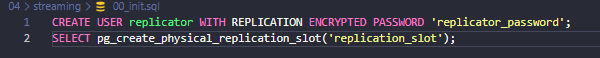

Pembahasan:

docker-compose.yml

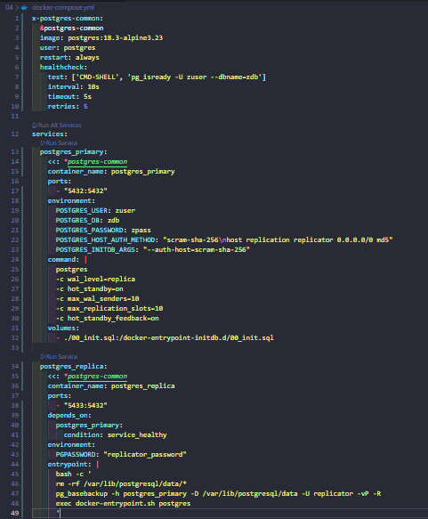

Pembahasan:

env.sh

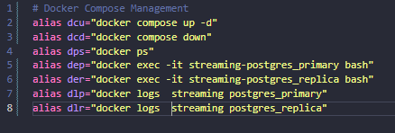

Pembahasan:

4.1.3 Menjalankan docker

1.

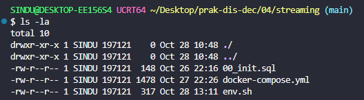

Pembahasan:

2.

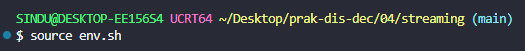
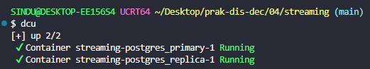
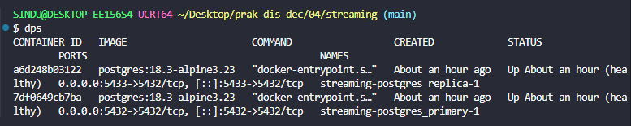

Pembahasan:

5.

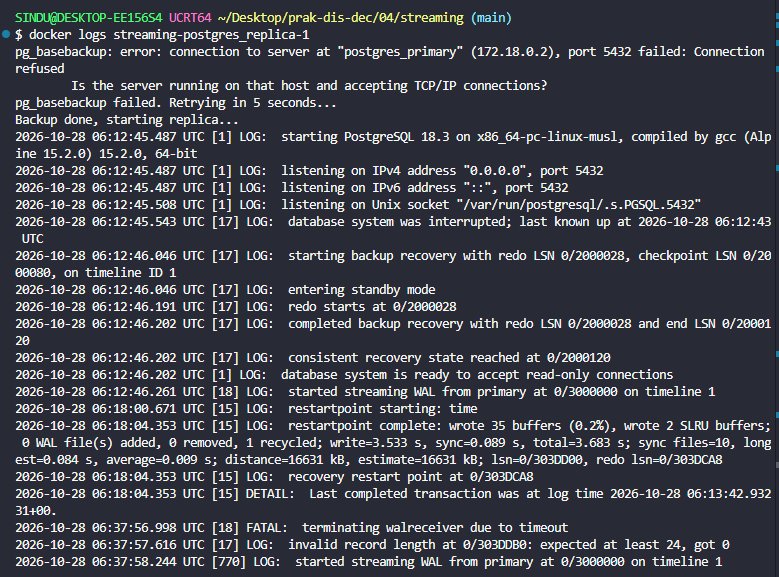

Pembahasan:

4.1.4 Pengujian

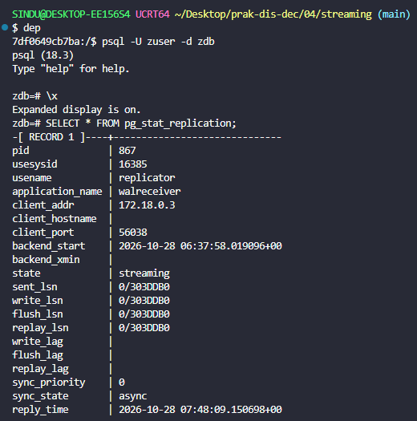
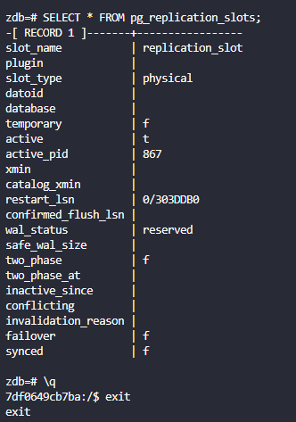

Pembahasan:

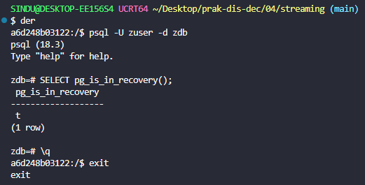

Pembahasan:

Sebelum pembuatan table

Primary

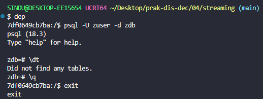

Pembahasan:

Manipulasi data pada primary

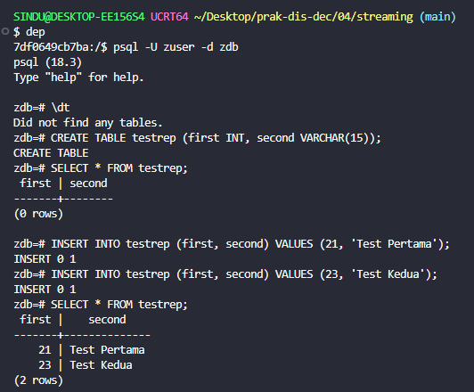

Pembahasan:

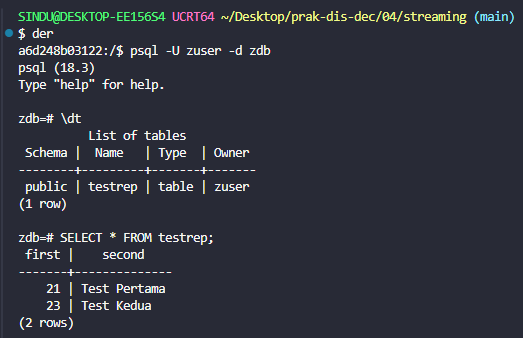

Pembahasan:

4.1.5 High-Availability

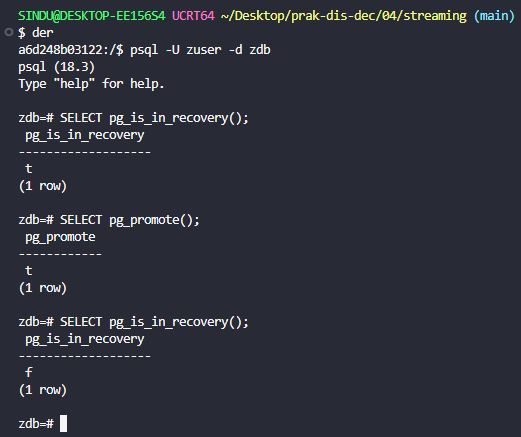

Pembahasan:

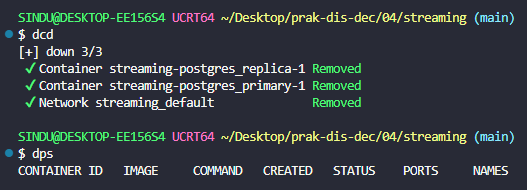

Pembahasan:


4.2 Replika pada master-master

Struktur direktori file

```text
04/
├── sql/
│   ├── current_catalog.sql
│   ├── ee_and_cust.sql
│   ├── invoices.sql
│   ├── media_and_genre.sql
│   ├── schema.sql
│   └── tracks.sql
├── docker-compose.yaml
└── env.sh
```

env.sh

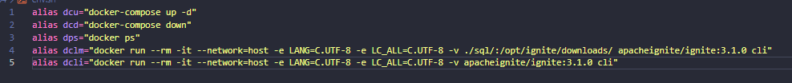

Pembahasan:

4.2.1 Menjalankan docker compose

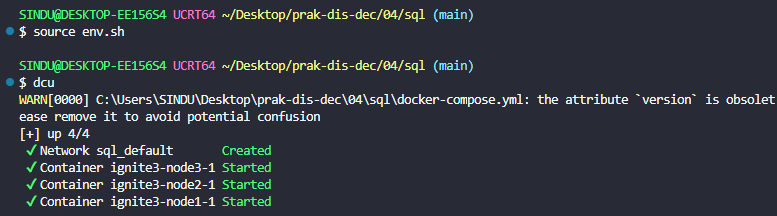

Pembahasan:

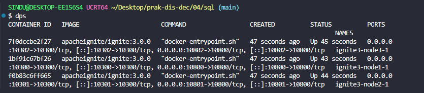

Pembahasan:

Tes ip

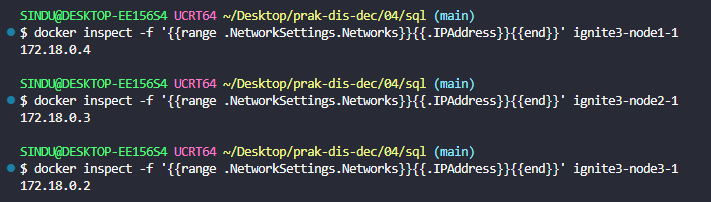

Pembahasan:

4.2.2 Instalasi cluster

```text
docker run --rm -it --network=host -e LANG=C.UTF-8 -e LC_ALL=C.UTF-8 apacheignite/ignite:3.1.0 cli
```
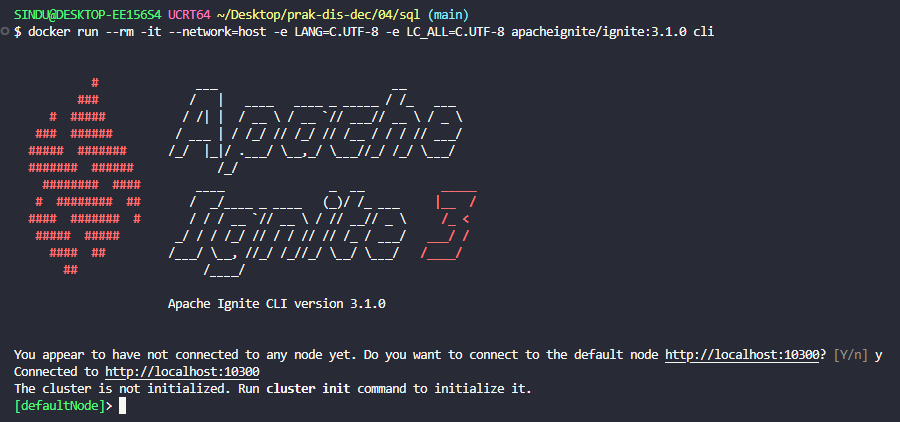
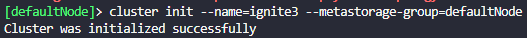
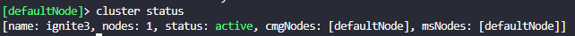

Pembahasan:


4.2.2 Eksekusi file Sql

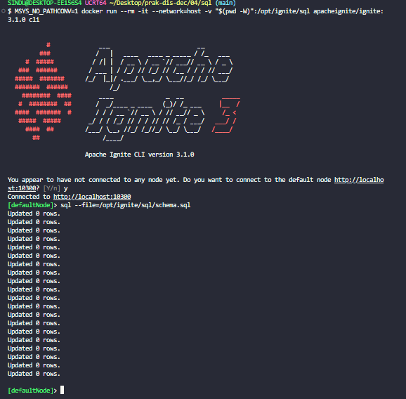

Pembahasan:

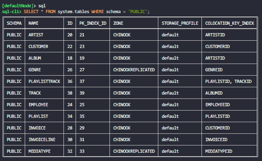

Pembahasan:

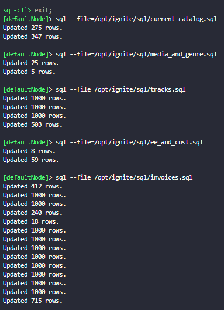

Pembahasan:

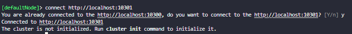
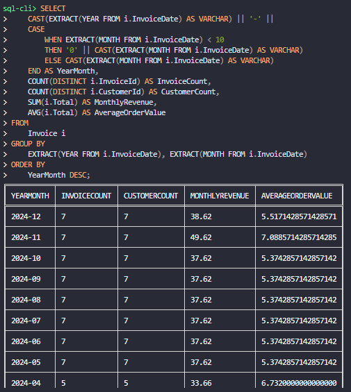

Pembahasan:

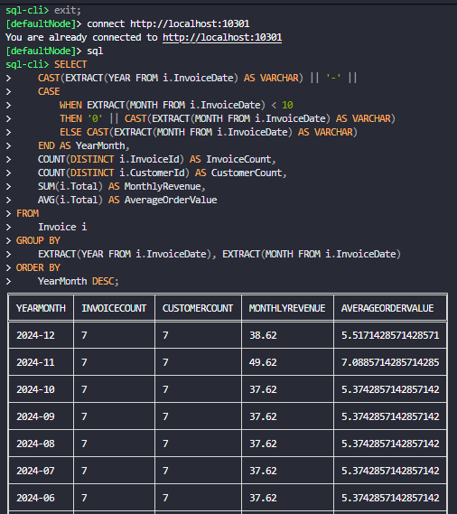

Pembahasan:

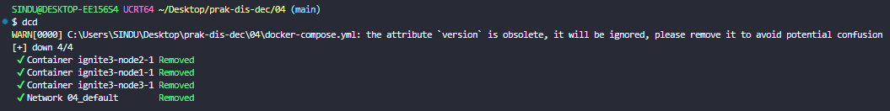

Pembahasan:


KESIMPULAN 


