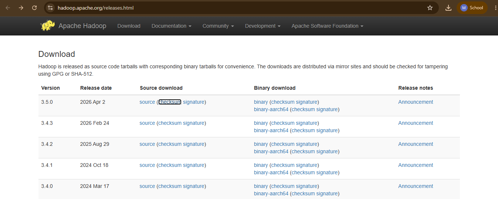
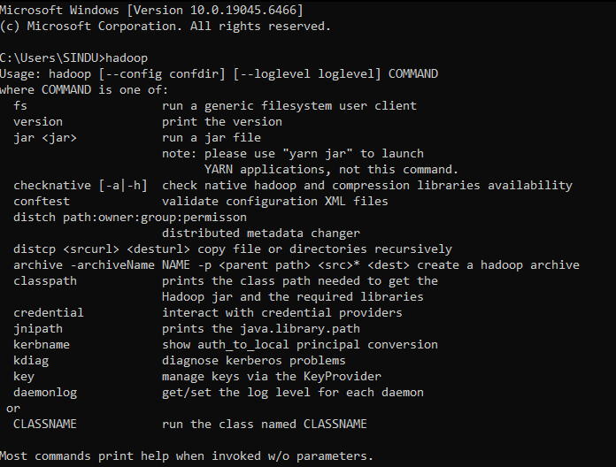
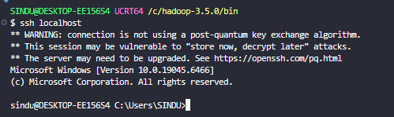
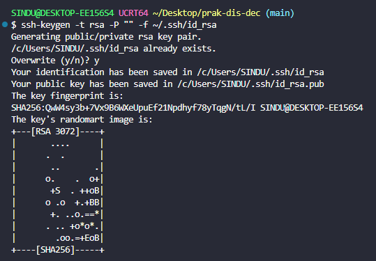
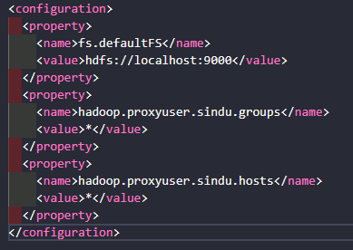
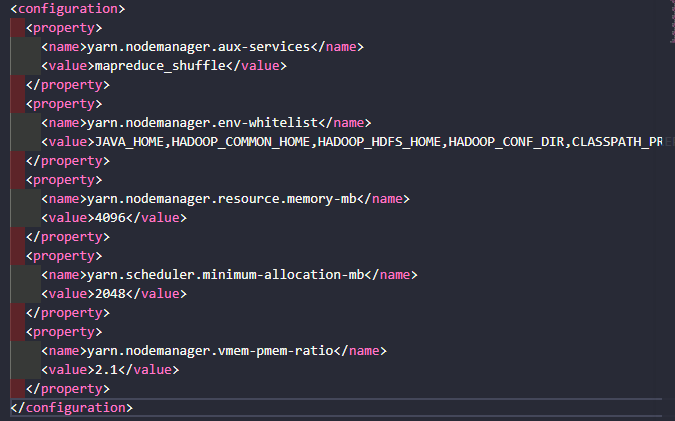
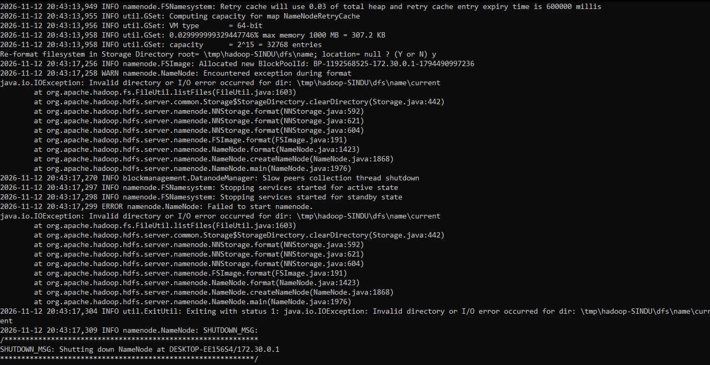
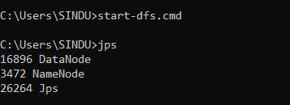

# Praktikum Apache Hadoop

**NIM: 255410033** 
**Nama: MOHAMAD SINDU OKTORINO** 

## Tujuan Praktikum

1. Memahami instalasi dan konfigurasi dasar Apache Hadoop.
2. Menyiapkan HDFS lokal dengan NameNode dan DataNode agar dapat dijalankan.
3. Mempraktikkan pembuatan direktori dan penyimpanan file di HDFS.

## Dasar Teori

Apache Hadoop adalah perangkat lunak untuk menyimpan dan memproses data secara terdistribusi. HDFS (Hadoop Distributed File System) membagi data menjadi blok dan mengelolanya melalui NameNode (metadata dan namespace) serta DataNode (penyimpanan blok). Pada konfigurasi satu komputer, nilai replikasi umumnya diatur menjadi satu.

Konfigurasi Hadoop disimpan dalam file XML. `core-site.xml` menentukan filesystem bawaan, `hdfs-site.xml` mengatur HDFS, `mapred-site.xml` mengatur MapReduce, dan `yarn-site.xml` mengatur layanan serta sumber daya YARN. Java dibutuhkan untuk menjalankan Hadoop, sedangkan SSH digunakan untuk komunikasi antarnode dan pengelolaan daemon.

## Praktikum

### 1. Unduh Apache Hadoop

**Pembahasan:**

Halaman resmi Apache Hadoop digunakan untuk memilih dan mengunduh distribusi Hadoop. Mengunduh dari situs resmi membantu memastikan berkas berasal dari sumber proyek.

### 2. Instalasi Apache Hadoop

**Pembahasan:**

Perintah `hadoop` menampilkan daftar perintah yang tersedia, menandakan CLI Hadoop dapat dipanggil dari terminal. Untuk memastikan versi dan instalasi, jalankan `hadoop version`.

### 3. Instalasi Pdsh

**Pembahasan:**

Gambar menunjukkan pengaktifan OpenSSH Server di Windows. Layanan SSH diperlukan agar Hadoop dapat menjalankan proses pada host melalui SSH; `pdsh` sendiri digunakan untuk mengirim perintah ke beberapa host.

**Pembahasan:**

Perintah `ssh localhost` menguji koneksi SSH ke komputer sendiri. Peringatan pada tangkapan layar berkaitan dengan algoritma pertukaran kunci dan tidak menghentikan koneksi.

- SSH keygen

**Pembahasan:**

`ssh-keygen` membuat pasangan kunci privat dan publik untuk autentikasi SSH. Tangkapan layar menunjukkan kunci sudah ada dan ditimpa; kunci privat harus dijaga, dan kunci publik perlu dipasang pada `authorized_keys` agar login tanpa kata sandi dapat digunakan.

### 4. Konfigurasi Apache Hadoop

#### hdfs-site.xml

**Pembahasan:**

`dfs.replication` diatur menjadi `1` untuk satu DataNode. Properti direktori NameNode dan DataNode menentukan lokasi metadata HDFS dan blok data pada komputer.

#### core-site.xml

**Pembahasan:**

`fs.defaultFS` mengarahkan klien ke NameNode pada `hdfs://localhost:9000`. Properti `hadoop.proxyuser.sindu.groups` dan `hosts` mengizinkan pengguna `sindu` melakukan operasi proxy dari grup dan host yang ditentukan.

#### mapred-site.xml

**Pembahasan:**

`mapreduce.framework.name` memilih YARN sebagai kerangka eksekusi MapReduce. `mapreduce.application.classpath` menyediakan lokasi pustaka yang diperlukan aplikasi MapReduce.

#### yarn-site.xml

**Pembahasan:**

Konfigurasi ini mengaktifkan layanan `mapreduce_shuffle`, menetapkan daftar variabel lingkungan yang diteruskan ke NodeManager, serta mengatur batas alokasi memori dan rasio memori virtual terhadap memori fisik.

### 5. Format Namenode

**Pembahasan:**

Format NameNode menginisialisasi metadata filesystem HDFS dan hanya dilakukan saat menyiapkan filesystem baru. Namun, gambar hasil menunjukkan proses gagal dengan `Invalid directory or I/O error` pada direktori `\tmp\hadoop-SINDU\dfs\name\current`; jadi format pada tangkapan layar ini belum berhasil. Periksa dan sesuaikan lokasi direktori penyimpanan dengan sistem operasi sebelum mencoba lagi. Pemformatan ulang dapat menghapus metadata HDFS yang sudah ada.

### 6. Test konfigurasi JAVA_HOME

**Pembahasan:**

Variabel `JAVA_HOME` diarahkan ke instalasi JDK 17 dan `HADOOP_HOME` ke folder Hadoop. Lokasi ini perlu sesuai dengan instalasi di komputer agar skrip Hadoop menemukan Java dan berkas distribusinya.

### 7. Jalankan daemon untuk HDFS

**Pembahasan:**

`start-dfs.cmd` menjalankan layanan HDFS. Hasil `jps` menampilkan proses `NameNode` dan `DataNode`, sedangkan antarmuka di `localhost:9870` menunjukkan NameNode aktif serta ringkasan status filesystem.

### 8. Selesai

**Pembahasan:**

Saat NameNode aktif dan layanan HDFS berjalan, filesystem siap menerima operasi seperti membuat direktori, mengunggah, dan melihat file. Setelah praktikum, hentikan layanan dengan skrip penghentian HDFS.

## Tugas

### 1. Buat direktori `/user/<nama-user>/datasets` di HDFS Anda

**Pembahasan:**

Perintah `hdfs dfs -mkdir -p /user/SINDU/datasets` membuat direktori tujuan di HDFS. Opsi `-p` juga membuat direktori induk yang belum tersedia.

### 2. Cari 3 file `.csv` di Internet, kemudian salin ketiga file tersebut ke direktori yang dibuat pada tugas 1

**Pembahasan:**

Tiga dataset—`iris.csv`, `tips.csv`, dan `titanic.csv`—diunduh ke komputer, lalu diunggah menggunakan `hdfs dfs -put`. Percobaan awal untuk mengunggah `dataset_kota.csv` gagal karena file tidak ditemukan. Perintah `hdfs dfs -ls` dan tampilan web HDFS kemudian menunjukkan ketiga file berhasil tersimpan di `/user/SINDU/datasets`.

## Kesimpulan

Praktikum ini mencakup persiapan Java dan SSH, konfigurasi Hadoop, serta pengoperasian HDFS lokal. Direktori dan tiga file CSV berhasil ditampilkan di HDFS pada hasil tugas. Meski demikian, tangkapan layar pemformatan NameNode menunjukkan kesalahan lokasi penyimpanan, sehingga langkah format perlu diperbaiki dan diverifikasi sebelum menyimpulkan bahwa inisialisasi berhasil.
