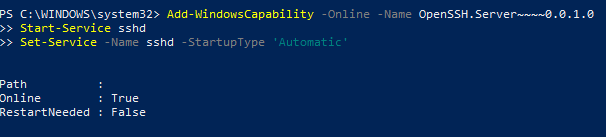
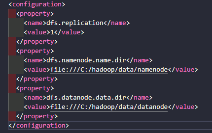
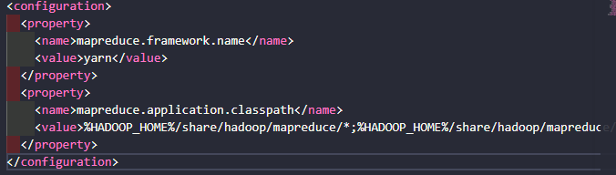
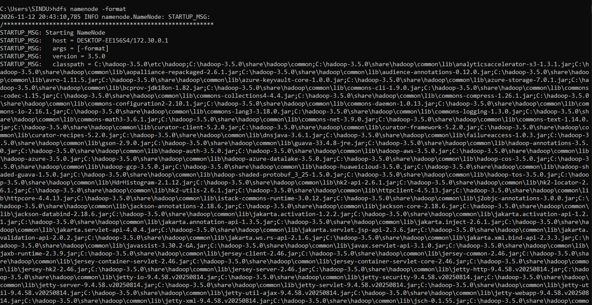
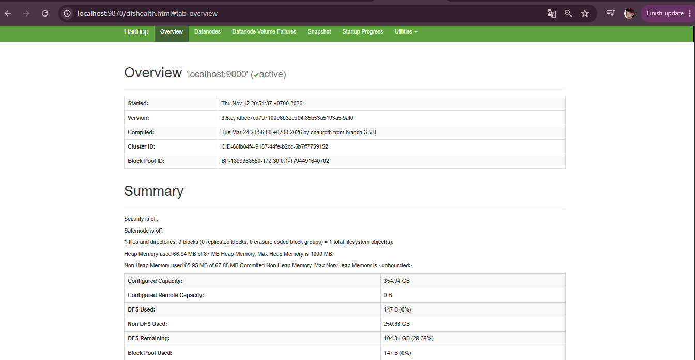
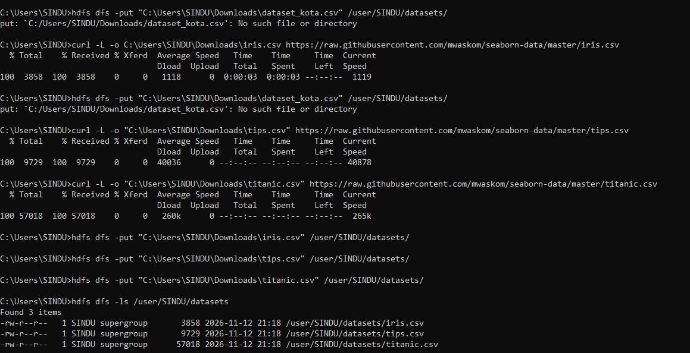
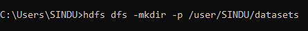
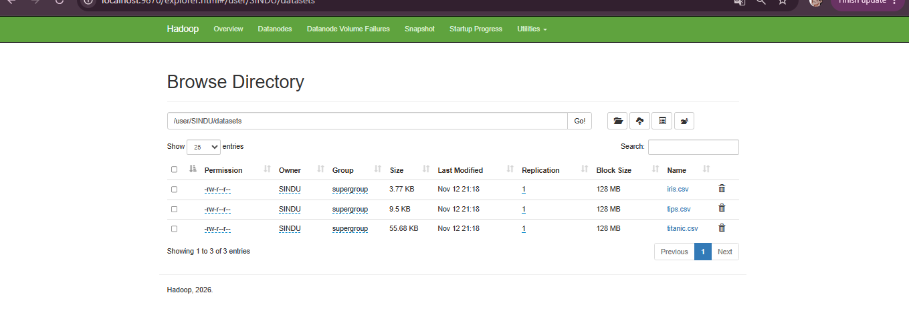

# Praktikum Apache Hadoop

**NIM:** 
**Nama:** 

## Tujuan Praktikum

## Dasar Teori

## Praktikum

### 1. Unduh Apache Hadoop

**Pembahasan:**

### 2. Instalasi Apache Hadoop

**Pembahasan:**

### 3. Instalasi Pdsh

**Pembahasan:**

-

**Pembahasan:**

- SSH keygen

**Pembahasan:**

### 4. Konfigurasi Apache Hadoop

#### hdfs-site.xml

**Pembahasan:**

#### core-site.xml

**Pembahasan:**

#### mapred-site.xml

**Pembahasan:**

#### yarn-site.xml

**Pembahasan:**

### 5. Format Namenode

**Pembahasan:**

### 6. Test konfigurasi JAVA_HOME

**Pembahasan:**

### 7. Jalankan daemon untuk HDFS

**Pembahasan:**

### 8. Selesai

**Pembahasan:**

## Tugas

### 1. Buat direktori `/user/<nama-user>/datasets` di HDFS Anda

**Pembahasan:**

### 2. Cari 3 file `.csv` di Internet, kemudian salin ketiga file tersebut ke direktori yang dibuat pada tugas 1

**Pembahasan:**

## Kesimpulan
