**NIM  : 255410033**
**Nama : Mohamad Sindu Oktorino**

## Tujuan Praktikum

Praktikum ini bertujuan untuk memahami konsep Cloud Computing dan pembagian layanan XaaS, yaitu SaaS, PaaS, dan IaaS. Praktikum juga bertujuan untuk mempraktikkan proses pembuatan Containerized App dari aplikasi Flask, membangun serta menjalankannya menggunakan Docker dan Podman, serta mempelajari pemetaan port agar aplikasi di dalam container dapat diakses melalui browser.

## Dasar Teori

Cloud Computing merupakan model penyediaan sumber daya komputasi yang dapat digunakan melalui layanan. Layanan ini umumnya dikelompokkan menjadi SaaS untuk penggunaan aplikasi melalui layanan, PaaS untuk pengembangan dan pengelolaan aplikasi, serta IaaS untuk penyediaan sumber daya infrastruktur seperti server, penyimpanan, dan jaringan.

Containerized App atau aplikasi berbasis container adalah aplikasi yang dikemas beserta dependensinya sehingga dapat dijalankan secara konsisten pada berbagai lingkungan. Docker dan Podman merupakan mesin container yang dapat membangun image dari Dockerfile, menjalankan aplikasi di dalam container, serta mengatur akses jaringan dengan pemetaan port. Dockerfile berisi petunjuk pembentukan image, sedangkan port mapping digunakan untuk menghubungkan port aplikasi pada container dengan port pada sistem host.

## Praktik

- Membuat folder home `src`

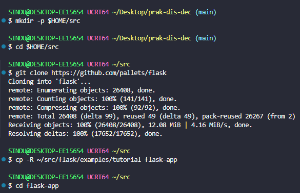

Pembahasan:

Aplikasi Flask tutorial disiapkan pada direktori kerja di bawah folder src. Direktori tutorial kemudian disalin ke folder flask-app agar menjadi proyek mandiri yang dapat dimodifikasi dan dikemas sebagai container.

### 1. Membuat Env Python 3.14.4

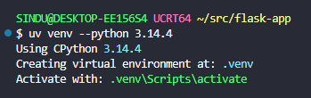

Pembahasan:

Lingkungan virtual Python dibuat untuk proyek flask-app agar dependensi aplikasi terisolasi. Penggunaan Python 3.14.4 memastikan aplikasi dan paket yang dibangun menggunakan versi interpreter sesuai kebutuhan praktikum.

### 2. Install Paket yang Diperlukan

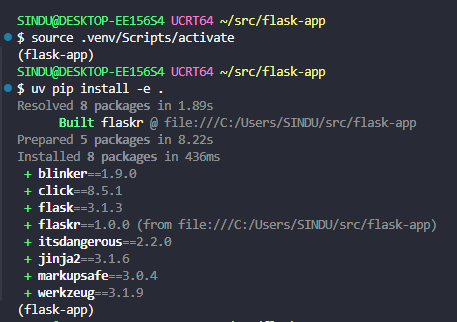

Pembahasan:

Perintah uv pip install -e . digunakan untuk memasang proyek Flask beserta seluruh dependensi yang tercantum pada konfigurasi proyek secara editable. Setelah proses instalasi selesai, database lokal perlu diinisialisasi agar fitur penyimpanan aplikasi tersedia.

Jalankan aplikasi tersebut setelah inisialisasi database.

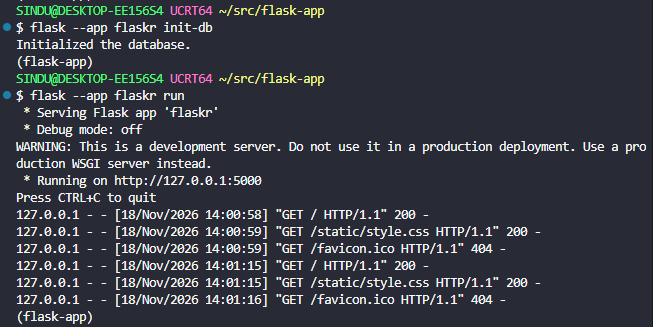

Pembahasan:

Perintah flask --app flaskr init-db membuat struktur database yang dibutuhkan aplikasi, sedangkan flask --app flaskr run menjalankan server pengembangan Flask pada port 5000. Aplikasi kemudian dapat diuji secara lokal dan ditandai berhasil jika halaman Flask dapat dibuka pada browser.

Lihat hasilnya pada browser.

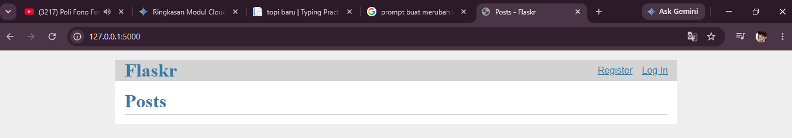

Pembahasan:

Halaman aplikasi menampilkan daftar posting tanpa data awal dan menyediakan menu Register serta Log In. Menu tersebut digunakan untuk menguji proses pembuatan akun dan autentikasi pengguna pada aplikasi Flask.

### 3. Membuat Aplikasi Menjadi CA dengan Docker

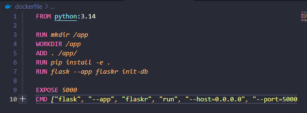

Pembahasan:

Dockerfile digunakan untuk membentuk image aplikasi. Docker base image dimulai dari Python 3.14, kemudian direktori kerja ditetapkan pada /app, seluruh kode proyek disalin ke image, dependensi dipasang, database diinisialisasi, port 5000 dibuka, dan Flask dijalankan sehingga dapat menerima koneksi dari luar container.

- Bangun image Docker.

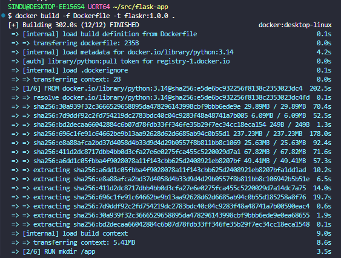
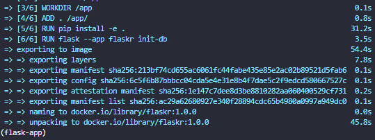

Pembahasan:

Docker daemon harus aktif sebelum proses build dimulai. Perintah docker build membaca Dockerfile dan menghasilkan image bernama flaskr dengan tag 1.0.0 berdasarkan kondisi proyek pada direktori saat ini.

- Image yang telah dibuat.

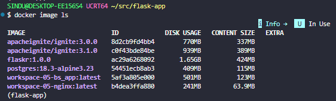

Pembahasan:

Image yang berhasil dibentuk dapat diperiksa dengan perintah docker image ls. Image yang tidak lagi digunakan sebaiknya dihapus berdasarkan ID-nya agar penyimpanan pada host tidak terisi oleh image yang tidak diperlukan.

### 4. Menjalankan Image

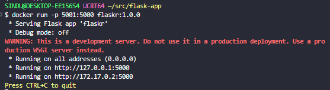

Pembahasan:

Container dijalankan dengan memetakan port 5000 pada container ke port 5001 pada host. Dengan pemetaan tersebut, aplikasi dapat diakses melalui http://localhost:5001 dan terbukti berhasil dijalankan sebagai Containerized App menggunakan Docker.

### 5. Membuat Aplikasi Menjadi CA dengan Podman

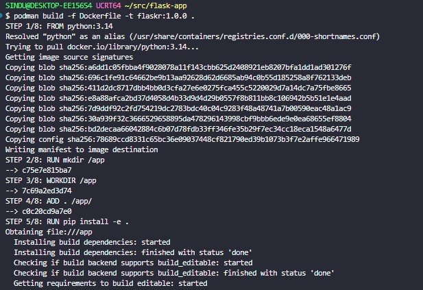
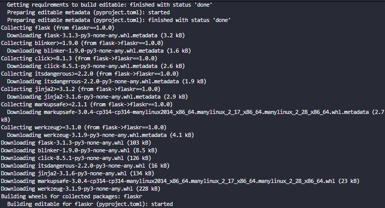
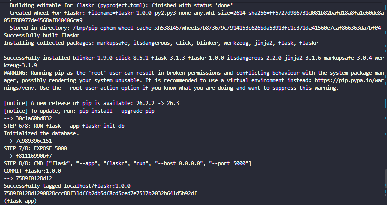

Pembahasan:

Podman dapat membangun aplikasi dari Dockerfile yang sama dan tidak memerlukan Docker daemon. Jika Docker aktif, Docker service perlu dihentikan terlebih dahulu pada distribusi yang menggunakan systemd atau dinit agar tidak terjadi konflik penggunaan runtime container.

- Image yang telah dibuat.

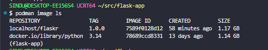

Pembahasan:

Perintah podman build membangun image flaskr:1.0.0 melalui delapan tahapan Dockerfile. Setiap tahapan menghasilkan lapisan image dan hasil akhir ditandai sebagai image dengan ID serta nama localhost/flaskr:1.0.0.

- Jalankan image menggunakan Podman.

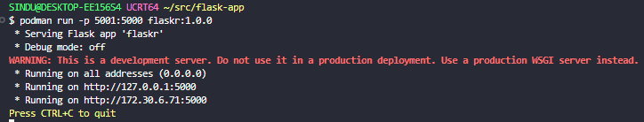

Pembahasan:

Container Podman dijalankan dengan pemetaan port yang sama, yaitu port 5001 pada host menuju port 5000 pada container. Browser yang mengakses localhost:5001 dapat menampilkan aplikasi Flask, sehingga proses build dan menjalankan image menggunakan Podman dinyatakan berhasil.

## Tugas

SaaS, PaaS, dan IaaS memiliki tingkat abstraksi dan tanggung jawab pengelolaan yang berbeda. Contoh SaaS adalah Google Workspace yang menyediakan aplikasi produktivitas seperti email, penyimpanan dokumen, dan kolaborasi langsung melalui browser. Pengguna hanya mengelola data serta konfigurasi layanannya, sementara penyedia mengelola aplikasi, runtime, sistem operasi, server, dan jaringan.

Contoh PaaS adalah Google App Engine yang menyediakan platform untuk membangun dan menjalankan aplikasi. Pengembang hanya mengelola kode serta konfigurasi aplikasi, sedangkan penyedia mengelola runtime, framework pendukung, sistem operasi, server, penyimpanan, dan skalabilitas.

Contoh IaaS adalah Google Compute Engine yang menyediakan virtual machine beserta kapasitas komputasi, penyimpanan, dan jaringan. Pengguna mengelola sistem operasi, runtime, aplikasi, serta konfigurasi keamanan, sedangkan penyedia mengelola server fisik, virtualisasi, jaringan dasar, dan pusat data.

## Kesimpulan

Praktikum Modul 7 memberikan pemahaman bahwa Cloud Computing menyediakan layanan komputasi melalui model SaaS, PaaS, dan IaaS sesuai kebutuhan pengguna. Praktikum ini juga membuktikan bahwa aplikasi Flask dapat dikemas sebagai Containerized App menggunakan Dockerfile, dibangun menjadi image, dan dijalankan pada Docker maupun Podman. Pemetaan port memungkinkan aplikasi yang berjalan di dalam container tetap dapat diakses melalui browser pada mesin host. Docker dan Podman memberikan cara yang konsisten untuk membangun dan menjalankan aplikasi secara terisolasi, portabel, serta mudah dipindahkan antarlingkungan.