

# PRAKTIKUM DISTRIBUTED SYSTEM

<table>
  <tr>
    <td><strong>NIM</strong></td>
    <td>255410033</td>
  </tr>
  <tr>
    <td><strong>Nama</strong></td>
    <td>MOHAMAD SINDU OKTORINO</td>
  </tr>
</table>

---

# TUJUAN PRAKTIKUM

Praktikum ini bertujuan agar mahasiswa mempelajari penggunaan FastAPI dan SQLModel dalam membangun layanan REST yang terhubung dengan database SQLite. Melalui praktikum ini, proses penyimpanan, pengambilan, dan penampilan data dapat dipahami sebagai satu alur yang saling berkaitan pada arsitektur layanan terpisah.

---

# DASAR TEORI

Layanan REST adalah cara bagi aplikasi untuk bertukar data melalui permintaan dan respons. FastAPI digunakan sebagai penghubung antara pengguna dan proses aplikasi, sedangkan SQLModel berfungsi untuk mengatur struktur data sekaligus menjalankan operasi pada database. SQLite digunakan sebagai penyimpanan data yang ringan dan dapat berjalan langsung pada perangkat tanpa server database tambahan.

Pada praktik ini, database berfungsi sebagai penyedia data, sedangkan layanan API mengambil data tersebut dan mengirimkannya dalam bentuk JSON. Setiap data disusun berdasarkan tabel yang memiliki kolom dan primary key sebagai pengenal utama setiap baris data.

---

# PRAKTIKUM

### I. Prasyarat

#### 1. Instalasi Python menggunakan uv - Python 3.14.4

  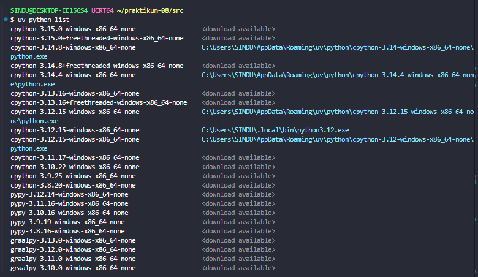

Pembahasan:

Pada tahap awal, Python versi 3.14.4 dipilih dan diaktifkan menggunakan uv. Penggunaan lingkungan Python yang terpisah membantu setiap praktikum tetap menggunakan versi yang sesuai dan tidak mengganggu instalasi Python pada sistem.

#### 2. Install paket FastAPI dan SQLModel

  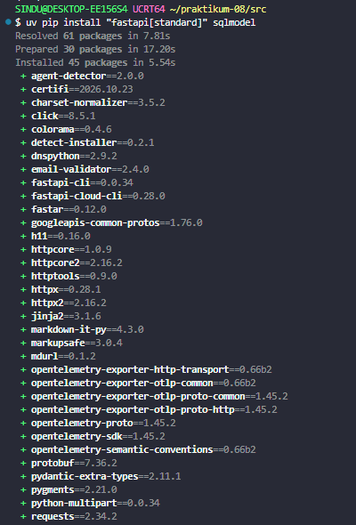

  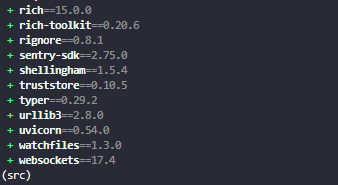

Pembahasan:

FastAPI dan SQLModel berhasil diinstal pada lingkungan Python yang digunakan. FastAPI digunakan untuk membuat layanan web dan endpoint, sementara SQLModel digunakan untuk mendefinisikan tabel serta menghubungkan aplikasi Python dengan database.

#### 3. Install SQLite jika belum ada di OS yang digunakan

  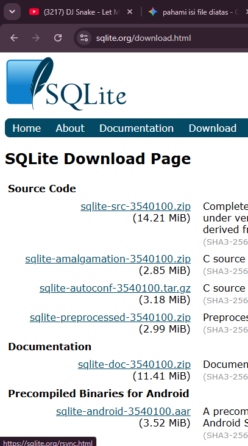

Pembahasan:

SQLite digunakan sebagai sistem penyimpanan data karena mudah digunakan dan tidak memerlukan proses server yang terpisah. Setelah tersedia pada sistem, SQLite dapat dijalankan melalui terminal untuk membuat tabel, memasukkan data, dan melihat hasil penyimpanan.

#### 4. Buat Database

  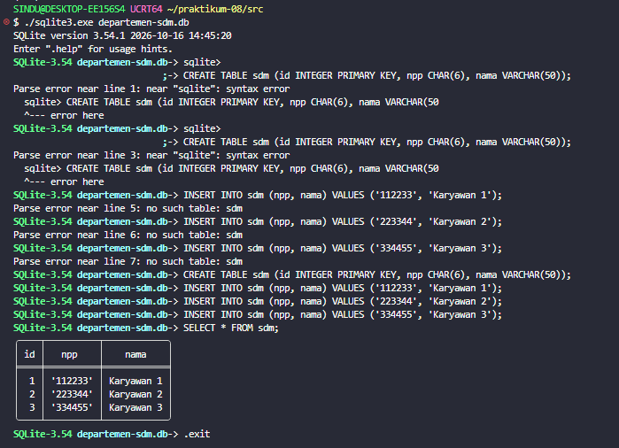

Pembahasan:

Database departemen-sdm dibuat menggunakan SQLite. Tabel SDM berisi primary key id serta kolom npp dan nama. Database ini menjadi sumber data yang kemudian ditampilkan melalui layanan API.

### II. Source Code

#### 1. Source Code servis.py

  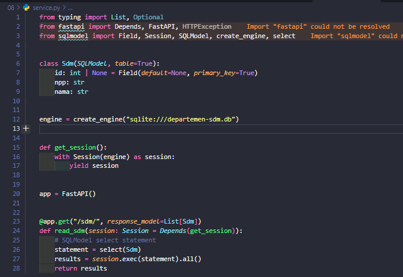

Pembahasan:

Source code menggunakan kelas Sdm sebagai representasi tabel pada database. Kolom id ditetapkan sebagai primary key, sedangkan npp dan nama digunakan sebagai data pegawai. Engine SQLite mengarahkan aplikasi ke database departemen-sdm, sedangkan session berfungsi mengelola koneksi ketika data diambil.

Endpoint /sdm/ dibuat menggunakan FastAPI dengan metode GET. Ketika endpoint diakses, aplikasi menjalankan perintah SQLModel untuk mengambil semua data pada tabel Sdm dan mengembalikannya sebagai respons JSON.

#### 2. Menjalankan Source Code

  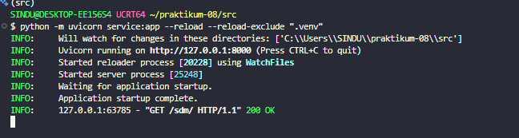

Pembahasan:

Source code dijalankan menggunakan Uvicorn sebagai server aplikasi. Perintah menjalankan FastAPI beserta nama aplikasi yang telah dibuat, sehingga layanan dapat diakses melalui browser atau alat pengujian seperti curl.

### Output

  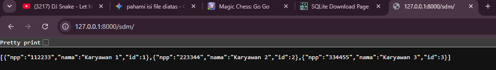

  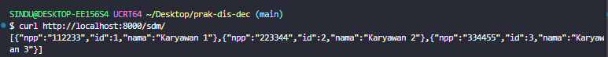

Pembahasan:

Hasil pengujian melalui browser dan curl memperlihatkan data pegawai dalam format JSON. Respons tersebut berasal dari tabel pada SQLite yang dibaca oleh SQLModel melalui endpoint FastAPI. Tampilan terminal juga menunjukkan bahwa server berhasil berjalan dan melayani permintaan.

---

# TUGAS

#### 1. Buat satu tabel baru menggunakan SQLite

Tabel harus berbeda dari tabel yang ada pada contoh. Tabel tersebut memiliki satu primary key dan setidaknya berisi data dengan tipe `INT`, `CHAR`, `VARCHAR`, `BOOLEAN`, dan `FLOAT`.

  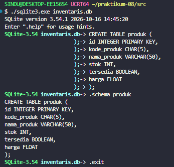

Pembahasan:

Tugas dilaksanakan dengan membuat tabel baru yang memiliki primary key serta lima jenis data yang diminta. Masing-masing kolom disusun agar dapat menyimpan nilai bilangan, teks, nilai benar atau salah, dan angka desimal.

#### 2. Isikan 5 data menggunakan script Python

  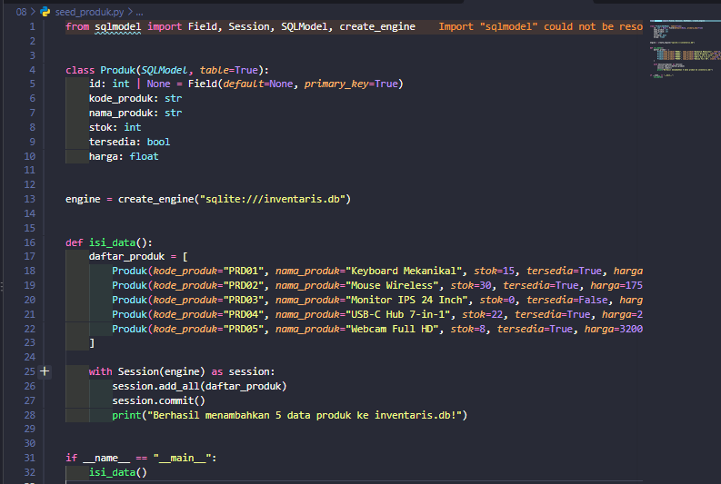

Pembahasan:

Lima baris data dimasukkan ke tabel menggunakan script Python. Penggunaan script memudahkan proses penyisipan data secara berulang tanpa harus memasukkan setiap nilai satu per satu melalui terminal SQLite.

#### 3. Buat RESTful API endpoint untuk menampilkan semua data yang telah diisikan

  

Pembahasan:

Endpoint REST dibuat untuk mengambil seluruh data pada tabel yang telah diisi. FastAPI menerima permintaan dari pengguna, SQLModel menjalankan proses pengambilan data, dan hasilnya dikirim kembali dalam format JSON.

#### 4. Tampilkan hasil RESTful API endpoint tersebut menggunakan curl

  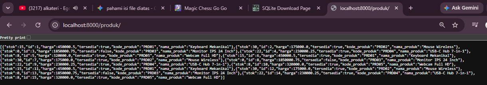

  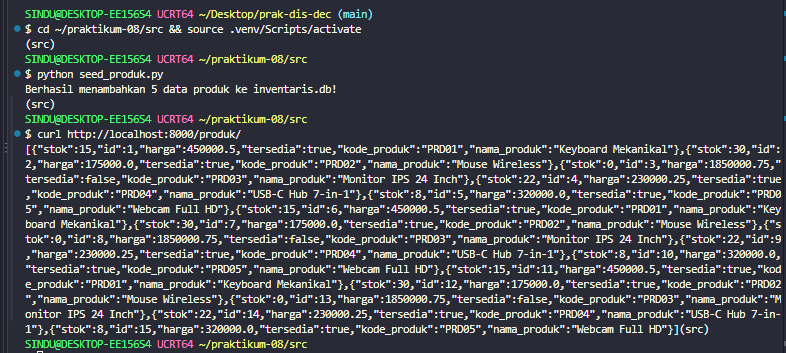

Pembahasan:

Pengujian dilakukan dengan curl pada alamat endpoint yang tersedia. Respons yang diterima harus menampilkan lima data yang telah dimasukkan sebelumnya. Hasil ini membuktikan bahwa data pada SQLite dapat diambil dan disajikan oleh layanan REST secara benar.

---

# KESIMPULAN

Praktikum ini menunjukkan bagaimana aplikasi Python dapat terhubung dengan database SQLite melalui SQLModel dan FastAPI. Database menyimpan data, SQLModel mengatur dan membaca data, sedangkan FastAPI menyediakan endpoint untuk menampilkan data kepada pengguna. Hasil pengujian membuktikan bahwa data dapat disimpan, diambil, dan ditampilkan melalui layanan REST menggunakan curl atau browser.
