**NIM:** 255410033  
**Nama:** Mohamad Sindu Oktorino

## 🎯 Tujuan Praktikum

Praktikum ini bertujuan agr mahasiswa memahami penerapan konsep Fault Tolerance pada sistem terdistribusi melalui penggunaan load balancing dan failure detection. Praktikum ini juga bertujuan mempelajari cara meningkatkan ketersediaan aplikasi menggunakan Docker dan Nginx, menjalankan beberapa instance aplikasi, serta memahami mekanisme pendeteksian kegagalan menggunakan heartbeat, retry mechanism, dan circuit breaker.

## 📚 Dasar Teori

Fault Tolerance merupakan kemampuan sistem untuk tetap beroperasi ketika terjadi kegagalan pada salah satu komponennya. Dalam sistem terdistribusi, konsep ini diterapkan untuk menjaga ketersediaan layanan dan mengurangi dampak kegagalan.

-Load balancing merupakan teknik pembagian beban permintaan ke beberapa instance aplikasi menggunakan proxy load balancer. Teknik ini membantu meningkatkan high availability dengan menjalankan lebih dari satu instance aplikasi. Pada praktikum ini, Nginx digunakan sebagai proxy untuk meneruskan permintaan pengguna ke aplikasi Blacksheep yang dijalankan menggunakan Docker.

-Failure Detection merupakan proses untuk menentukan apakah suatu komponen 
mengalami kegagalan. Salah satu mekanismenya adalah heartbeat, yaitu protokol untuk memantau aktivitas komponen. Jika komponen pemantau tidak menerima heartbeat dalam jangka waktu tertentu, komponen tersebut diasumsikan mengalami kegagalan atau tidak responsif.

-Retry mechanism digunakan untuk mengelola percobaan ulang koneksi ketika terjadi kegagalan komunikasi dengan komponen di luar aplikasi. Pada praktikum ini, library Tenacity digunakan untuk membantu mengatur proses percobaan ulang tersebut.

-Circuit breaker merupakan pola desain yang digunakan dalam microservices untuk mencegah kegagalan berantai dengan memblokir sementara permintaan ke layanan yang mengalami kegagalan. Circuit breaker memiliki tiga status, yaitu Closed untuk mengizinkan permintaan, Open untuk menolak sementara permintaan, dan Half-Open untuk menguji apakah layanan sudah kembali pulih.


## 🧪 Praktikum

### ⚖️ 4.1 Load Balancing Aplikasi

#### 1. Persiapan

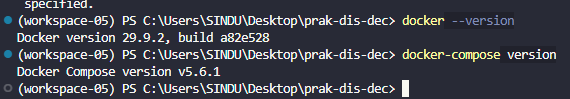

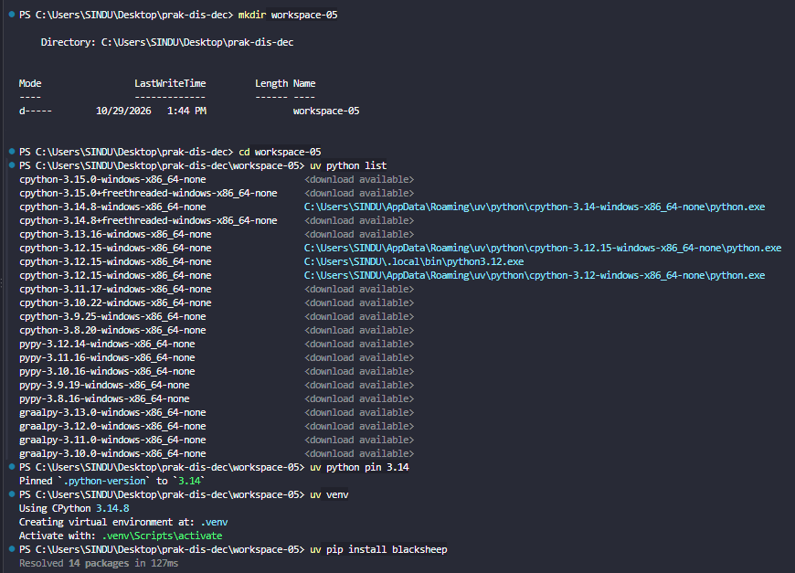

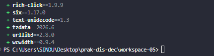

**📝 Pembahasan:**
Pada tahap persiapan, dilakukan pemeriksaan instalasi Docker dan Docker Compose untuk memastikan lingkungan praktikum siap digunakan. Pemeriksaan dilakukan melalui terminal dengan melihat versi masing-masing perangkat lunak. Selain itu, disiapkan lingkungan Python menggunakan virtual environment agar proses instalasi library dapat berjalan secara terpisah dari sistem utama.

#### 2. Pembuatan Aplikasi Web

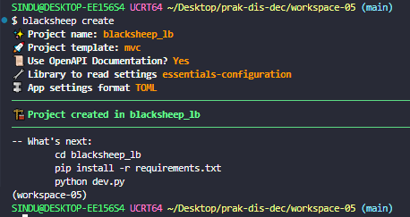

**📝 Pembahasan:**

Pada tahap ini, aplikasi web dibuat menggunakan framework Blacksheep dengan perintah blacksheep create. Pembuatan aplikasi menggunakan template MVC dan konfigurasi OpenAPI. Setelah proses pembuatan selesai, terbentuk direktori aplikasi blacksheep_lb yang berisi kode program dan konfigurasi pendukung.

**📦 Install package yang diperlukan**

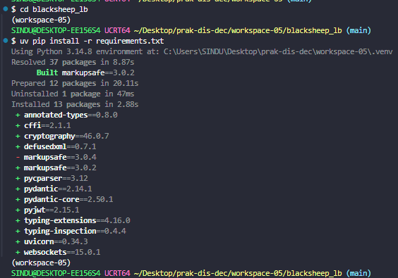

**📝 Pembahasan:**

Tahap ini dilakukan dengan menginstal library yang dibutuhkan aplikasi melalui file requirements.txt. Library tersebut digunakan untuk mendukung proses pengembangan dan menjalankan aplikasi Blacksheep. Instalasi dilakukan agar seluruh dependensi yang dibutuhkan tersedia sebelum aplikasi dijalankan.

**✅ Memastikan aplikasi berjalan lancar**

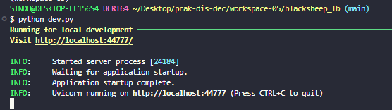

**📝 Pembahasan:**

Setelah instalasi selesai, aplikasi dijalankan menggunakan perintah python dev.py. Server kemudian berjalan menggunakan Uvicorn pada alamat http://localhost:44777. Hasil tersebut menunjukkan bahwa aplikasi berhasil dijalankan dan siap diakses melalui browser.

**🖥️ Cek server**

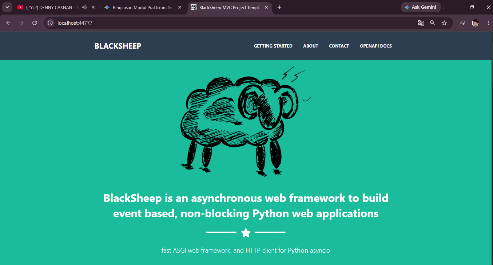

**📝 Pembahasan:**

Pada tahap ini dilakukan pemeriksaan proses server melalui terminal. Hasil pemeriksaan menunjukkan bahwa Uvicorn berhasil menjalankan aplikasi dan menampilkan informasi status server. Hal tersebut membuktikan bahwa aplikasi telah berjalan pada port 44777.

**✅ Cek keberhasilan membuat server**

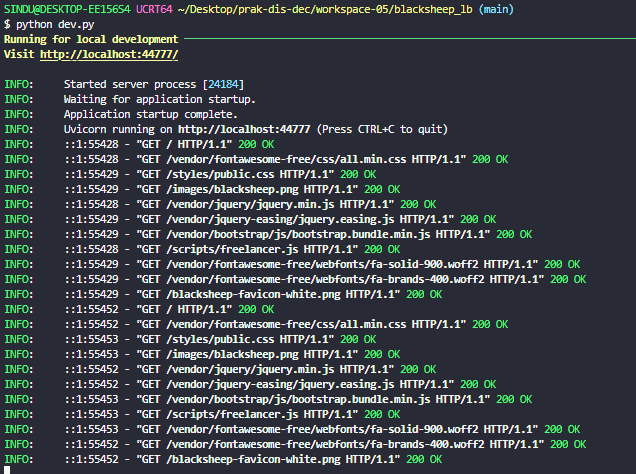

**📝 Pembahasan:**

Pengujian dilakukan dengan mengakses alamat localhost melalui browser. Halaman aplikasi Blacksheep berhasil ditampilkan sehingga dapat diketahui bahwa server mampu menerima dan memberikan respons terhadap permintaan pengguna.

**📂 Mengecek seluruh struktur direktori**

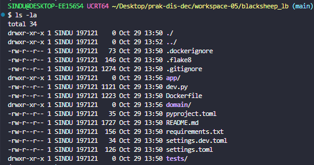

**📝 Pembahasan:**

Tahap ini dilakukan untuk memeriksa struktur direktori aplikasi menggunakan perintah ls. Hasilnya menunjukkan bahwa direktori aplikasi telah memiliki folder dan file yang diperlukan, seperti app, domain, tests, Dockerfile, requirements.txt, dan file konfigurasi lainnya.

#### 03. Siapkan Dockerfile dan docker-compose.yml

```text
├── blacksheep_lb
│   ├── app
│   ├── dev.py
│   ├── Dockerfile
│   ├── domain
│   ├── pyproject.toml
│   ├── README.md
│   ├── requirements.txt
│   ├── settings.dev.toml
│   ├── settings.toml
│   └── tests
├── docker-compose.yml
├── env.sh
└── nginx
    ├── Dockerfile
    └── nginx.conf

6 directories, 11 files
```

**📝 Pembahasan:**

Tahap ini dilakukan untuk memeriksa struktur direktori aplikasi menggunakan perintah ls. Hasilnya menunjukkan bahwa direktori aplikasi telah memiliki folder dan file yang diperlukan, seperti app, domain, tests, Dockerfile, requirements.txt, dan file konfigurasi lainnya.

**🐳 Dockerfile (blacksheep_lb)**

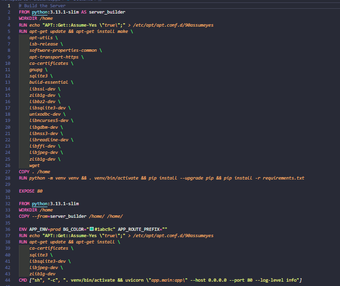

**📝 Pembahasan:**

Dockerfile digunakan untuk membangun image aplikasi Blacksheep berdasarkan Python. Konfigurasi di dalamnya mencakup instalasi dependensi, pembuatan virtual environment, serta pengaturan aplikasi agar berjalan pada port 80. Dockerfile ini memungkinkan aplikasi dijalankan dalam container secara terpisah dari lingkungan lokal.

**🐳 Cek Dockerfile Nginx**

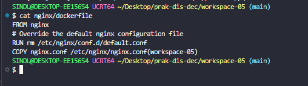

**📝 Pembahasan:**

Pada tahap ini dilakukan pemeriksaan Dockerfile Nginx. File tersebut menggunakan image dasar Nginx dan mengganti konfigurasi bawaan dengan file nginx.conf. Pengaturan ini diperlukan agar Nginx menggunakan konfigurasi load balancing yang telah disiapkan.

**⚙️ nginx.conf**

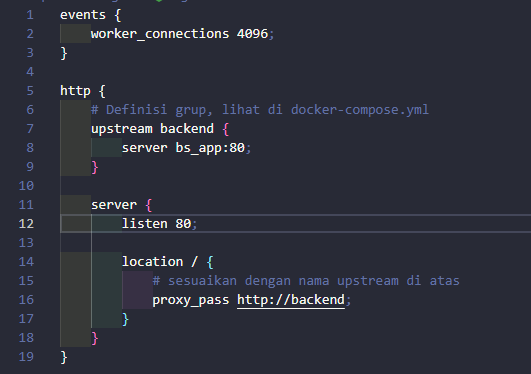

**📝 Pembahasan:**

File nginx.conf digunakan untuk mengatur Nginx sebagai reverse proxy. Konfigurasi upstream bernama backend diarahkan ke layanan bs_app pada port 80. Ketika pengguna mengakses Nginx, permintaan akan diteruskan menuju layanan aplikasi melalui konfigurasi proxy_pass.

**🐳 docker-compose.yml**

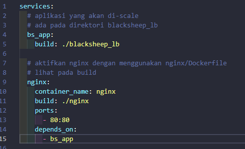

**📝 Pembahasan:**

File Docker Compose digunakan untuk mengatur layanan aplikasi Blacksheep dan Nginx dalam satu lingkungan container. Layanan bs_app berfungsi menjalankan aplikasi, sedangkan layanan nginx bertugas menerima permintaan melalui port 80 dan meneruskannya ke aplikasi. Konfigurasi depends_on memastikan layanan aplikasi menjadi dependensi Nginx.

**🔧 env.sh**

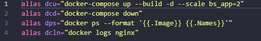

**📝 Pembahasan:**

File env.sh berisi beberapa alias untuk mempermudah penggunaan perintah Docker melalui terminal. Alias tersebut digunakan untuk menjalankan container, menghentikan layanan, memeriksa container yang aktif, dan melihat log Nginx. Dengan konfigurasi ini, pengelolaan layanan dapat dilakukan lebih praktis.

#### 4. Jalankan Docker Compose

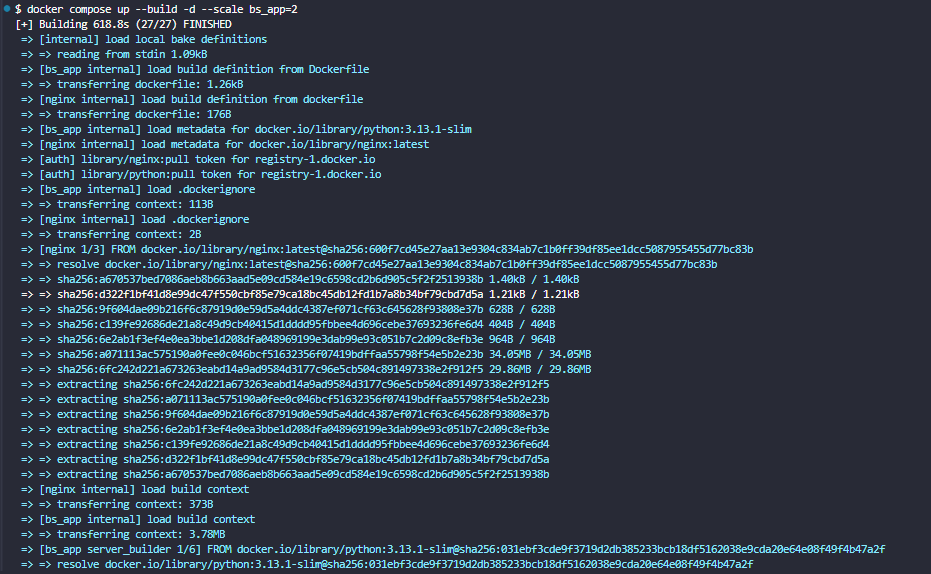
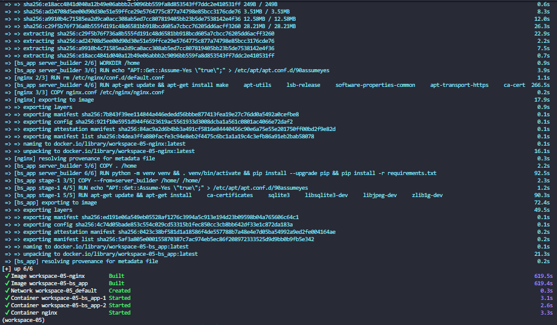

**📝 Pembahasan:**

Pada tahap ini, seluruh layanan dijalankan menggunakan Docker Compose dengan perintah docker compose up --build -d --scale bs_app=2. Perintah tersebut digunakan untuk membangun image, menjalankan container di latar belakang, dan membuat dua instance aplikasi Blacksheep. Hasil proses menunjukkan bahwa pembangunan image berhasil dilakukan.

**🖥️ Cek server**

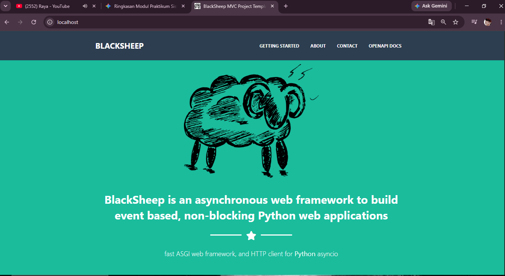

**📝 Pembahasan:**

Setelah Docker Compose dijalankan, aplikasi diperiksa melalui browser menggunakan alamat http://localhost. Halaman aplikasi berhasil ditampilkan melalui layanan Nginx pada port 80. Hal ini menunjukkan bahwa Nginx dapat meneruskan permintaan menuju aplikasi Blacksheep yang berjalan di dalam container.

**🔎 Dps**

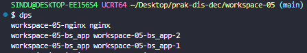

**📝 Pembahasan:**

Pemeriksaan dilakukan menggunakan perintah dps untuk melihat container yang sedang berjalan. Hasilnya menunjukkan terdapat tiga container, yaitu satu container Nginx dan dua container aplikasi Blacksheep. Kondisi tersebut membuktikan bahwa proses scaling aplikasi berhasil dilakukan.

**⚖️ Load balancing**

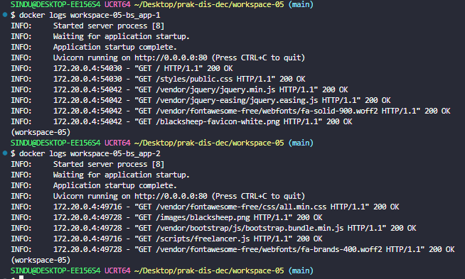

**📝 Pembahasan:**

Pada tahap ini dilakukan pemeriksaan log menggunakan perintah docker logs pada masing-masing container aplikasi. Log menunjukkan adanya permintaan HTTP yang berhasil diproses dengan status 200 OK. Pemeriksaan ini digunakan untuk mengetahui aktivitas permintaan yang diterima oleh instance aplikasi dalam konfigurasi load balancing.

**🔎 dcd**

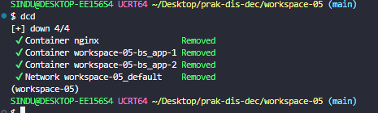

**📝 Pembahasan:**

Tahap terakhir dilakukan dengan menjalankan perintah dcd untuk menghentikan seluruh layanan Docker Compose. Hasilnya menunjukkan bahwa container Nginx, kedua container aplikasi Blacksheep, dan jaringan Docker berhasil dihapus. Dengan demikian, lingkungan praktikum dapat dihentikan setelah pengujian selesai

### 💓 4.2 Failure Detection

**💓 Heartbeat check-server**

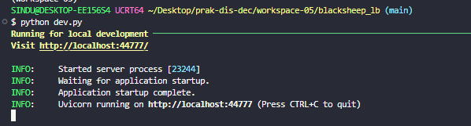
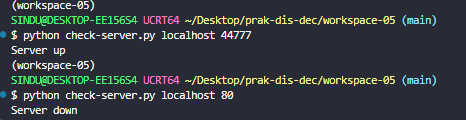

**📝 Pembahasan:**

Pada tahap ini dilakukan pengujian mekanisme heartbeat menggunakan file check-server.py. Program memanfaatkan library socket untuk memeriksa koneksi server berdasarkan host dan port yang ditentukan. Pengujian pertama dilakukan ketika aplikasi Blacksheep aktif pada port 44777 dan menghasilkan pesan Server up. Pengujian berikutnya dilakukan menggunakan port 82 yang tidak aktif dan menghasilkan pesan Server down. Hasil tersebut menunjukkan bahwa program dapat mendeteksi kondisi server berdasarkan keberhasilan koneksi.

**🔁 Heartbeat check-retry**

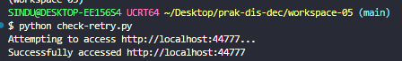
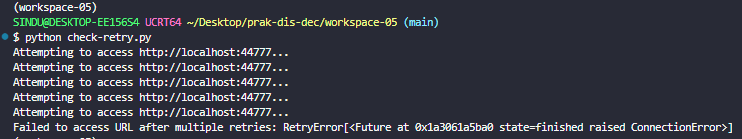

**📝 Pembahasan:**

Pengujian selanjutnya menggunakan file check-retry.py dengan bantuan library Tenacity dan Requests. Program melakukan permintaan HTTP ke aplikasi Blacksheep dan mencoba kembali ketika terjadi kegagalan koneksi. Ketika aplikasi tidak aktif, proses percobaan ulang dilakukan hingga mencapai batas maksimal lima kali dan menghasilkan pesan kegagalan. Ketika aplikasi aktif, permintaan berhasil diproses dan menampilkan pesan Successfully accessed. Pengujian ini menunjukkan bahwa mekanisme retry dapat membantu mengatasi kegagalan koneksi sementara.


**⏱️ Heartbeat check-t-break**

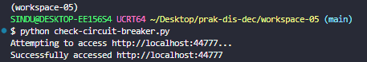
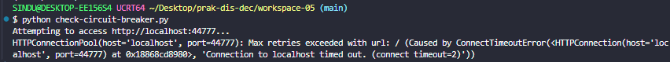

**📝 Pembahasan:**

Pada tahap ini dilakukan pengujian menggunakan file check-circuit-breaker.py untuk memeriksa akses HTTP ke aplikasi Blacksheep. Ketika aplikasi aktif, permintaan berhasil dilakukan dan menampilkan pesan Successfully accessed. Sebaliknya, ketika aplikasi tidak aktif, program menghasilkan pesan kesalahan koneksi karena server tidak memberikan respons. Hasil pengujian menunjukkan perbedaan kondisi akses ketika layanan tersedia dan ketika layanan mengalami kegagalan.

## ✅ Kesimpulan

Praktikum Modul 5 memberikan pemahaman mengenai penerapan Fault Tolerance dalam sistem terdistribusi. Pada bagian Load Balancing, aplikasi Blacksheep berhasil dijalankan menggunakan Docker dengan dua instance dan Nginx sebagai reverse proxy. Pada bagian Failure Detection, dilakukan pengujian menggunakan heartbeat, retry mechanism, dan pemeriksaan koneksi melalui circuit breaker. Hasil praktikum menunjukkan bahwa mekanisme tersebut dapat membantu memantau ketersediaan layanan dan menangani kondisi kegagalan koneksi dalam sistem terdistribusi.